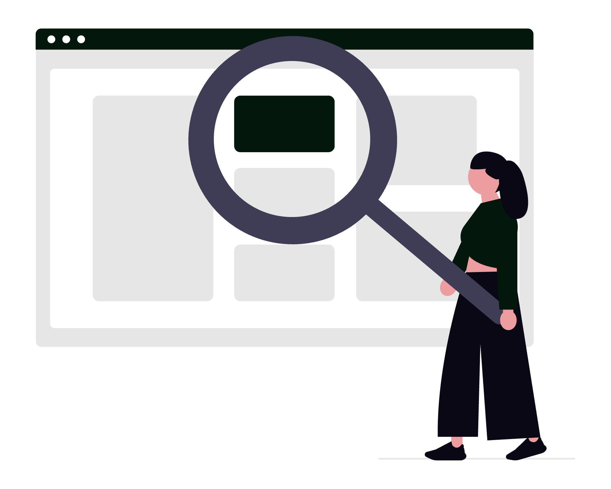
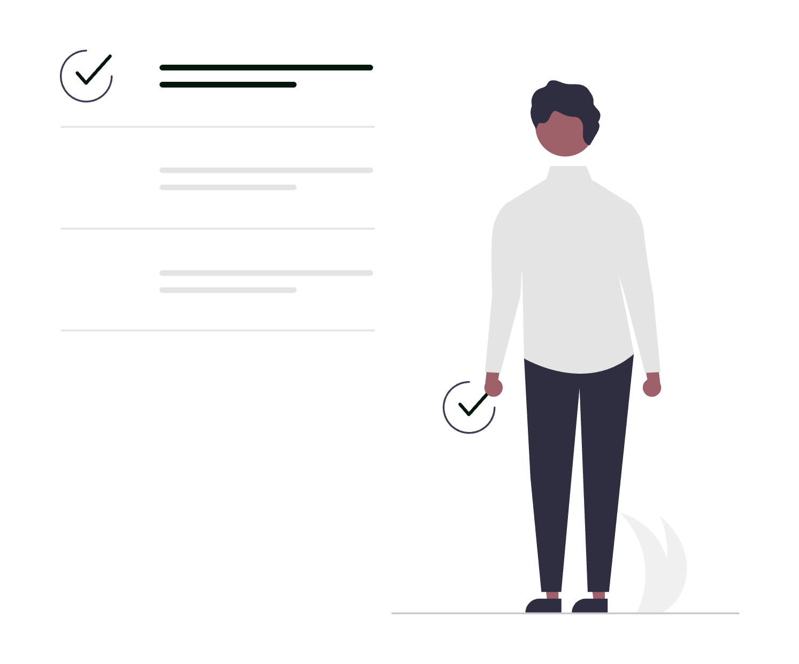

# Audit website de avocat: ce trebuie să știi?

Un potențial client îți află numele de la un prieten, îl caută pe telefon și decide în câteva minute dacă te sună. Tot ce vede în acel moment, de la rezultatul din Google până la numărul de telefon de pe website, ține de tine. Vestea bună este că poți verifica singur cea mai mare parte, fără cunoștințe tehnice. Mai jos ai un self-test în zece puncte: pentru fiecare vezi cum verifici și ce faci dacă punctul pică.

  

    
  

*Actualizat: octombrie 2026.*

**Acest material are caracter informativ și nu constituie consultanță juridică.** Este realizat de SOLON, agenția digitală pentru avocați din România.

## Înainte să începi

Ai nevoie de un telefon, de un laptop și de aproximativ o oră. Deschide o fereastră de navigare privată (incognito), ca rezultatele să nu fie influențate de istoricul tău.

Notează pentru fiecare punct „trece” sau „pică”, plus o propoziție despre ce ai văzut. La final ai o listă clară de lucruri de rezolvat, în ordinea importanței.

## 1. Ce apare când îți cauți numele în Google

**Cum verifici:** caută pe telefon „avocat [numele tău]” și „[numele cabinetului] [orașul]”. Uită-te la prima pagină de rezultate: apare website-ul tău? Apare profilul Google al cabinetului? Datele din rezultate (adresă, telefon, program) sunt cele actuale?

**Ce faci dacă pică:** dacă website-ul nu apare deloc, verifică punctul 10 (indexarea). Dacă apar date vechi, cauza este de obicei un profil Google neactualizat sau un director online cu informații expirate.

Corectează întâi sursele pe care le controlezi: website-ul și profilul Google.

## 2. Ce spun ChatGPT și alți asistenți AI despre tine

**Cum verifici:** întreabă ChatGPT, Gemini sau alt asistent: „Cine este avocatul [numele tău] din [oraș] și cu ce se ocupă?”. Notează ce răspunde: datele sunt corecte, incomplete sau confundate cu altcineva? Răspunsurile diferă de la o zi la alta și de la un asistent la altul, așa că repetă întrebarea de două-trei ori.

**Ce faci dacă pică:** asistenții AI își iau informațiile din surse publice, printre altele, de pe website-ul tău și din profilurile oficiale. O pagină „Despre” clară, cu numele complet, baroul, orașul și ariile de practică, plus [datele structurate](../date-structurate-schema-org-pentru-avocati/) pe website, îi ajută să te descrie corect. Detaliile despre cum funcționează acest tip de vizibilitate le găsești în ghidul [cum apari în ChatGPT, Gemini și Google AI Overviews](../avocat-chatgpt-gemini-ai-overviews/). Nimeni nu poate garanta ce răspunde un asistent AI; poți doar să-i oferi informații corecte și coerente.

## 3. Cât de repede se încarcă website-ul pe mobil

**Cum verifici:** deschide [PageSpeed Insights](https://pagespeed.web.dev/), introdu adresa website-ului și uită-te la rezultatele pentru mobil. Google recomandă trei praguri pentru o experiență bună, măsurate la percentila 75 a vizitelor reale (datele din teren din PageSpeed) ([Web Vitals](https://web.dev/articles/vitals)):

| Indicator | Ce măsoară | Prag recomandat |
|---|---|---|
| **LCP** (Largest Contentful Paint) | cât durează până apare conținutul principal | cel mult 2,5 secunde |
| **INP** (Interaction to Next Paint) | cât de repede reacționează pagina la o atingere | cel mult 200 de milisecunde |
| **CLS** (Cumulative Layout Shift) | cât de mult „sar” elementele în timpul încărcării | cel mult 0,1 |

**Ce faci dacă pică:** cele mai frecvente cauze sunt imaginile foarte mari, prea multe scripturi externe (chat, hărți, statistici) și găzduirea lentă. Raportul PageSpeed îți arată exact ce elemente încetinesc pagina; trimite-l celui care îți administrează website-ul.

## 4. Cum arată website-ul pe telefon

**Cum verifici:** deschide website-ul pe telefon și parcurge fiecare pagină importantă. Textul se citește fără zoom? Meniul se deschide? Butoanele se pot atinge ușor? Google folosește versiunea pentru mobil a paginilor ca să le indexeze și să le claseze ([indexarea mobile-first](https://developers.google.com/search/docs/crawling-indexing/mobile/mobile-sites-mobile-first-indexing)), deci ce lipsește pe mobil contează și pentru căutare.

**Ce faci dacă pică:** dacă versiunea mobilă ascunde conținut, are texte tăiate sau butoane suprapuse, problema ține de șablonul website-ului. Uneori se rezolvă cu ajustări, alteori merită refăcut. Ghidul despre [crearea unui website de avocat](../creare-site-avocati/) te ajută să decizi.

## 5. Datele de contact și formularul

**Cum verifici:**
- Telefonul se poate apela cu o singură atingere?
- Adresa de e-mail funcționează? Trimite-ți un mesaj de test.
- Adresa biroului și programul sunt cele actuale și identice pe toate paginile?
- Completează formularul de contact și verifică dacă mesajul ajunge și în cât timp.

**Ce faci dacă pică:** un formular care nu trimite mesajele este una dintre cele mai frecvente probleme și una dintre cele mai greu de observat, pentru că nimeni nu te anunță că mesajul s-a pierdut. Repară-l imediat și repetă testul lunar. Ghidul despre [mentenanța website-ului](../mentenanta-site-avocati/) explică ce alte verificări periodice merită făcute.

## 6. Profilul Google Business

**Cum verifici:** caută numele cabinetului în Google Maps. Profilul există? Este revendicat și verificat? Categoria, adresa, telefonul, programul și link-ul către website sunt corecte? Google cere ca datele să reflecte cabinetul așa cum este cunoscut în realitate ([regulile Google pentru profilurile de business](https://support.google.com/business/answer/3038177)).

**Ce faci dacă pică:** dacă nu ai profil sau nu ai acces la el, urmează pașii de [verificare a profilului](https://support.google.com/business/answer/7107242). Pentru configurarea completă ai ghidul [Google Business Profile pentru avocați](../google-business-profile-avocati/), cu toate câmpurile importante.

## 7. HTTPS și certificatul de securitate

**Cum verifici:** deschide website-ul și uită-te la bara de adrese. Adresa începe cu `https://` și browserul nu afișează niciun avertisment? Încearcă și varianta cu `http://` și pe cea fără `www`: toate ar trebui să ducă automat la aceeași adresă securizată.

**Ce faci dacă pică:** un avertisment de securitate îl face pe vizitator să închidă pagina. De obicei, cauza este un certificat expirat sau o configurare incompletă.

Este o reparație rapidă pentru cine administrează găzduirea, dar trebuie făcută imediat.

## 8. Cine are acces la domeniu, găzduire și website

**Cum verifici:** fă o listă cu trei rânduri: domeniul, găzduirea și contul de administrare al website-ului. Pentru fiecare notează pe numele cui este, cine are parola și când expiră. Pentru un domeniu `.ro`, pornești de la căutarea WHOIS pe [rotld.ro](https://www.rotld.ro/), unde vezi data expirării și registrarul.

**Ce faci dacă pică:** dacă nu știi răspunsul la un rând, cere-l în scris furnizorului. Pașii detaliați, inclusiv ce faci când domeniul este pe numele altcuiva, sunt în ghidul [domeniu și email profesional pentru cabinet](../domeniu-email-profesional-cabinet-avocat/).

## 9. Informațiile legale și regulile profesiei

**Cum verifici:**
- Website-ul are o politică de confidențialitate care descrie prelucrările reale și cuprinde informațiile cerute de art. 13 din [Regulamentul (UE) 2016/679](https://legislatie.just.ro/Public/DetaliiDocumentAfis/201834)?
- Dacă folosești cookie-uri care nu sunt strict necesare (de exemplu, pentru statistici), vizitatorul își dă acordul înainte ca ele să fie plasate? Potrivit art. 4 alin. (5) din [Legea nr. 506/2004](https://legislatie.just.ro/Public/DetaliiDocument/56973), stocarea de informații în dispozitivul vizitatorului sau accesul la informațiile deja stocate acolo sunt permise numai dacă vizitatorul și-a dat acordul, după ce a primit, înainte de acord, informații clare și complete, inclusiv despre scop. Excepțiile sunt la alin. (6): stocarea făcută exclusiv pentru transmiterea unei comunicări și cea strict necesară pentru un serviciu pe care vizitatorul l-a cerut în mod expres. Textul legii trimite încă la Legea nr. 677/2001, abrogată; trimiterea se citește acum ca trimitere la Regulamentul (UE) 2016/679 (art. V din [Legea nr. 129/2018](https://legislatie.just.ro/Public/DetaliiDocument/201712)).
- Textele de pe website respectă regulile de publicitate ale profesiei? Le găsești în [Statutul profesiei de avocat](https://www.unbr.ro/statutul-profesiei-de-avocat/) (art. 243¹–243³ și anexele nr. XXXIII și XXXIV) și în Codul deontologic al avocatului (art. 20): de exemplu, fără informații înșelătoare, fără garantarea rezultatului și fără mențiuni despre rezultatele obținute sau despre identitatea clienților.

**Ce faci dacă pică:** un link către politica de confidențialitate sau un banner de cookie-uri nu înseamnă automat conformitate; contează ce se întâmplă efectiv pe website. Pentru regulile de publicitate, ghidul [ce are voie un avocat să publice online](../ce-are-voie-avocat-sa-publice-online/) explică limitele, cu trimiteri la textele aplicabile. Pentru o situație concretă, consultă baroul din care faci parte.

## 10. Indexarea în Google Search Console

**Cum verifici:** dacă ai acces la Google Search Console pentru website, folosește [instrumentul de inspecție a adreselor URL](https://support.google.com/webmasters/answer/9012289) pe pagina principală și pe paginile de servicii. Vezi dacă sunt indexate și dacă Google semnalează erori.

**Ce faci dacă pică:** dacă nu ai cont, ghidul [cum să folosești Google Search Console ca avocat](../cum-sa-folosesti-google-search-console-ca-avocat/) îți arată cum îl configurezi. Dacă paginile nu sunt indexate, cauza poate fi o setare tehnică (de exemplu, o pagină blocată pentru motoarele de căutare) sau conținut prea sumar. Verifică și dacă paginile pentru fiecare arie de practică au conținut propriu; ghidul despre [paginile de arii de practică](../pagini-arii-de-practica-website-avocat/) te ajută să le structurezi.

  

    
  

## Checklist: self-testul pe scurt

| # | Verificare | Trece dacă |
|---|---|---|
| 1 | Căutare după nume în Google | website-ul și profilul Google apar, cu date actuale |
| 2 | Asistenți AI | descrierea ta este corectă și nu e confundată cu altcineva |
| 3 | Viteză pe mobil | LCP, INP și CLS sunt în pragurile recomandate |
| 4 | Afișare pe telefon | totul se citește și se atinge ușor, fără zoom |
| 5 | Contact și formular | telefonul, e-mailul și formularul funcționează |
| 6 | Profil Google Business | revendicat, verificat și la zi |
| 7 | HTTPS | fără avertismente, toate variantele duc la `https://` |
| 8 | Acces la domeniu și găzduire | știi titularul, parolele și datele de expirare |
| 9 | Informații legale | confidențialitate, cookie-uri și reguli de publicitate verificate |
| 10 | Indexare | paginile importante sunt indexate, fără erori |

Pe lângă cele zece puncte, merită să te uiți și la imaginea de ansamblu: fotografiile de pe website, LinkedIn și profilul Google sunt aceleași și recente? Ghidul despre [fotografia profesională pentru avocați](../fotografie-profesionala-pentru-avocati/) te ajută cu asta. Iar dacă folosești și rețelele sociale, vezi [ce formate funcționează pe Instagram și Facebook](../instagram-facebook-pentru-avocati-ce-formate-functioneaza/).

## Întrebări frecvente

### Ce este un audit de website pentru un cabinet de avocat?

Este o verificare a felului în care website-ul și prezența online a cabinetului funcționează pentru un potențial client: dacă te găsește, dacă pagina se încarcă repede pe telefon, dacă datele de contact sunt corecte și dacă informațiile legale sunt la locul lor. O parte o poți face singur, cu instrumente gratuite precum PageSpeed Insights și Google Search Console.

### Pot face singur auditul website-ului, fără cunoștințe tehnice?

Da, pentru majoritatea verificărilor din acest ghid: căutarea după nume, testul pe telefon, testarea formularului și controlul profilului Google. Pentru remedierea problemelor tehnice, cum ar fi viteza, certificatul sau indexarea, ai nevoie de obicei de persoana care îți administrează website-ul.

### Cât de des ar trebui să verific website-ul cabinetului?

O dată la trei luni este un ritm rezonabil, plus după orice schimbare importantă, precum un website nou, o adresă nouă sau un furnizor nou. Formularul de contact merită testat lunar.

### De ce contează ce răspunde ChatGPT despre mine?

Unii potențiali clienți pun întrebări direct asistenților AI. Acestea își iau informațiile din surse publice, iar dacă datele de pe website și din profilurile tale sunt incomplete sau contradictorii, răspunsul poate fi greșit. Nu poți controla ce răspunde un asistent AI, dar poți publica informații corecte și coerente despre tine.

### Ce verific primul dacă am puțin timp?

Formularul de contact și numărul de telefon, pentru că o problemă acolo înseamnă mesaje pierdute. Apoi căutarea după nume în Google și profilul Google Business, pentru că sunt primele lucruri pe care le vede un potențial client.

## Surse

- [PageSpeed Insights](https://pagespeed.web.dev/) - Google
- [Web Vitals: praguri pentru LCP, INP și CLS](https://web.dev/articles/vitals) - web.dev (Google)
- [Indexarea mobile-first: bune practici](https://developers.google.com/search/docs/crawling-indexing/mobile/mobile-sites-mobile-first-indexing) - Google Search Central
- [Instrumentul de inspecție a adreselor URL](https://support.google.com/webmasters/answer/9012289) - Google Search Console Help
- [Reguli pentru reprezentarea afacerii pe Google](https://support.google.com/business/answer/3038177) - Google Business Profile Help
- [Verificarea profilului de business pe Google](https://support.google.com/business/answer/7107242) - Google Business Profile Help
- [WHOIS pentru domenii.ro](https://www.rotld.ro/) - RoTLD
- [Regulamentul (UE) 2016/679 (GDPR)](https://legislatie.just.ro/Public/DetaliiDocumentAfis/201834) - legislatie.just.ro
- [Legea nr. 506/2004, art. 4 alin. (5)-(6)](https://legislatie.just.ro/Public/DetaliiDocument/56973) - legislatie.just.ro
- [Legea nr. 129/2018, art. V (abrogarea Legii nr. 677/2001)](https://legislatie.just.ro/Public/DetaliiDocument/201712) - legislatie.just.ro
- [Statutul profesiei de avocat, art. 243¹–243³](https://www.unbr.ro/statutul-profesiei-de-avocat/) - UNBR

## Despre autor

Ghidul este realizat de echipa SOLON, agenția digitală pentru avocați din România. Lucrăm cu cabinete și societăți de avocatură la website-uri, SEO, profiluri Google Business și vizibilitate în căutările cu AI. Alte resurse pe [solon.agency](https://solon.agency/).

Dacă vrei să treci prin acest self-test împreună cu cineva și să afli ce merită rezolvat primul, poți [programa gratuit o sesiune de consultanță de 30 de minute](https://solon.agency/programare-consultanta-gratuita/) cu echipa SOLON.

---

> *Prezentul articol are un caracter pur informativ și educațional și nu constituie consultanță juridică în sensul Legii nr. 51/1995. Pentru o situație concretă, consultă un avocat.*
>
> *Articol redactat cu asistență AI, verificat și asumat editorial de echipa SOLON.*
