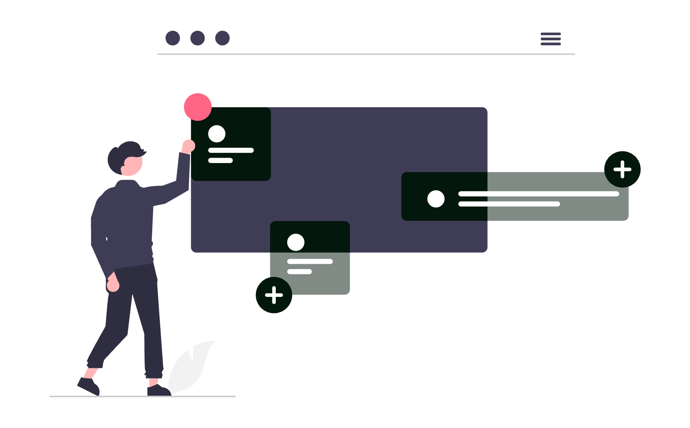

# Date structurate (schema.org) pentru avocați: cum te înțeleg Google și ChatGPT

Dacă numele tău este și numele altui avocat, Google și un asistent de chat pot amesteca cele două practici: adresa unuia, ariile celuilalt, un telefon care nu mai este al tău. Pagina spune lucrurile astea în propoziții, dar o mașină le ghicește. Datele structurate sunt varianta scurtă și standard a acelorași fapte, ca să se vadă cine ești, unde ești și cu ce te ocupi.

<div class="row justify-content-center my-4">
  <div class="col-md-9">
    
  </div>
</div>

## 1. Ce sunt datele structurate

[Datele structurate](../glosar-marketing-digital-avocati/#term-date-structurate) sunt fapte despre pagină, scrise într-un format pe care un program îl poate citi fără să interpreteze un paragraf. Vocabularul folosit aproape peste tot este [schema.org](https://schema.org/). Forma pe care o recomandă Google este JSON-LD: un bloc de text, pus în pagină, care nu se vede pentru vizitator.

Nu înlocuiesc textul paginii. Îl repetă, într-o formă fixă. Dacă pe pagină scrie că ești avocat în Cluj și în marcaj apare București, marcajul este greșit, nu „mai tehnic”. Ghidul Google spune că datele structurate trebuie să descrie conținutul vizibil.

Termenul pe care îl vei vedea în oferte este [schema markup](../glosar-marketing-digital-avocati/#term-schema-markup). Este același lucru: etichetele prin care spui că un nume este numele cabinetului, nu titlul unui articol.

## 2. De ce le citește Google

Pentru o afacere locală, [Google documentează tipul `LocalBusiness`](https://developers.google.com/search/docs/appearance/structured-data/local-business). Proprietățile cerute sunt `name` și `address`. Restul, telefon, program, imagine, adresă web, crește calitatea descrierii, dar nu este pe lista de obligatorii. `LegalService`, tipul pentru un cabinet, este un fel de `LocalBusiness`, deci aceleași două câmpuri rămân baza.

La organizații, Google spune că marcajul de pe pagina principală îl ajută să deosebească entitatea ta de altele cu nume apropiat și poate influența detalii precum logo-ul din panoul de cunoștințe. Nu spune că marcajul stabilește ordinea rezultatelor.

Asta se leagă de profilul tău public. Numele, adresa și telefonul din marcaj trebuie să fie aceleași cu cele din [Google Business Profile](../google-business-profile-avocati/). Dacă profilul spune o stradă și website-ul alta, ai două versiuni ale aceluiași cabinet.

## 3. Ce poți aștepta de la ChatGPT și Gemini

ChatGPT și Gemini nu sunt Google. Niciunul nu publică o regulă de forma „pune JSON-LD și vei fi citat”. Pentru funcțiile generative din Google Search, [ghidul oficial din mai 2026](https://developers.google.com/search/docs/fundamentals/ai-optimization-guide) spune că datele structurate nu sunt obligatorii. [Pagina despre funcțiile AI](https://developers.google.com/search/docs/appearance/ai-features) precizează că nu există un tip schema.org special pentru răspunsurile generate și că indexarea nu este promisă. În același ghid din mai 2026, „AEO” și „GEO” nu sunt o disciplină separată de SEO.

Marcajul rămâne util mai îngust: pune în vocabular comun faptele pe care un sistem le poate amesteca, numele cabinetului, numele avocatului, localitatea și ariile în care lucrezi. Cum aleg asistenții sursele este tratat în ghidul despre [cum apare un avocat în ChatGPT, Gemini și AI Overviews](../avocat-chatgpt-gemini-ai-overviews/). Dacă cineva îți vinde marcajul ca pe o cheie către acele răspunsuri, ghidul din mai 2026 spune contrariul.

## 4. Patru tipuri și unul care s-a învechit

Pentru un cabinet, patru tipuri acoperă aproape tot ce merită descris.

<div class="table-wrap">

| Tip | Pe cine descrie | Unde stă, de obicei |
|---|---|---|
| `LegalService` | Cabinetul, ca activitate locală | Pagina principală sau pagina de contact |
| `Person` | Avocatul, ca persoană | Pagina de prezentare |
| `FAQPage` | Întrebările vizibile pe pagină | Doar pagina care chiar are acele întrebări |
| `Attorney` | Vechiul tip pentru „avocat” ca firmă | Nu îl mai folosi pentru un marcaj nou |

</div>

`Attorney` încă există pe schema.org, dar [pagina tipului](https://schema.org/Attorney) îl marchează ca învechit: [`LegalService`](https://schema.org/LegalService) este mai cuprinzător și mai puțin ambiguu. Un tip învechit nu este o eroare de sintaxă. Este o etichetă pe care vocabularul nu o mai recomandă.

`Person` este pentru om, nu pentru firmă. `jobTitle` poate fi „avocat”. Nu pune un titlu de specialist dacă nu îl ai în condițiile legii. `worksFor` leagă persoana de cabinet prin `@id`, nu prin a doua copie a adresei.

`FAQPage` descrie întrebările și răspunsurile vizibile pe pagină. [Din 8 august 2023, Google limita afișarea extinsă la website-uri guvernamentale și de sănătate](https://developers.google.com/search/blog/2023/08/howto-faq-changes). [Pe 8 mai 2026 a anunțat că funcția nu mai apare deloc în Google Search din 7 mai 2026, iar în iunie 2026 a retras documentația](https://developers.google.com/search/updates). Întrebările rămân pentru cititor.

## 5. Unde pui blocul în pagină

JSON-LD stă într-un element `<script type="application/ld+json">`, de obicei în `<head>`. Vizitatorul nu îl vede. Un singur bloc poate conține mai multe obiecte, legate prin `@graph` și prin `@id`.

Trei reguli practice:

- Cabinetul are un `@id` stabil, de forma `https://example.com/cabinet-exemplu/#cabinet`. Celelalte pagini trimit la el, nu îl redefinesc cu altă adresă.
- Fiecare pagină descrie ce se vede pe ea. Pagina unei arii de practică nu repetă întregul istoric al tuturor colegilor.
- Nu pui marcaj pentru recenzii pe care nu le afișezi. Google cere ca recenzia să fie vizibilă și să fie despre altcineva decât propria afacere. Pentru un cabinet, zona asta este și una pe care regulile profesiei o tratează strict. O lași goală.

## 6. Exemplu JSON-LD pentru un cabinet fictiv

Exemplul de mai jos nu descrie un client și nu descrie SOLON. Numele, strada, telefonul și domeniul sunt inventate. `example.com` este un domeniu rezervat pentru exemple, nu un website real. Poți lipi blocul într-un test. Nu îl publica neschimbat.

```json
{
  "@context": "https://schema.org",
  "@graph": [
    {
      "@type": "LegalService",
      "@id": "https://example.com/cabinet-exemplu/#cabinet",
      "name": "Cabinet de Avocat Exemplu",
      "url": "https://example.com/cabinet-exemplu/",
      "image": "https://example.com/cabinet-exemplu/portret.jpg",
      "telephone": "+40-21-000-0000",
      "address": {
        "@type": "PostalAddress",
        "streetAddress": "Strada Exemplu nr. 10",
        "addressLocality": "București",
        "postalCode": "010101",
        "addressCountry": "RO"
      },
      "areaServed": "București"
    },
    {
      "@type": "Person",
      "@id": "https://example.com/cabinet-exemplu/#ana-exemplu",
      "name": "Ana Exemplu",
      "jobTitle": "avocat",
      "url": "https://example.com/cabinet-exemplu/ana-exemplu/",
      "image": "https://example.com/cabinet-exemplu/portret.jpg",
      "worksFor": { "@id": "https://example.com/cabinet-exemplu/#cabinet" },
      "knowsAbout": ["drept civil", "dreptul muncii"]
    },
    {
      "@type": "FAQPage",
      "mainEntity": [
        {
          "@type": "Question",
          "name": "În ce situații de drept civil lucrează cabinetul?",
          "acceptedAnswer": {
            "@type": "Answer",
            "text": "Textul acesta trebuie să fie identic cu răspunsul vizibil pe pagină."
          }
        }
      ]
    }
  ]
}
```

Comentariile cu `//` nu sunt JSON valid și pică la test. De aceea explicația stă lângă cod, nu în interiorul lui.

<div class="row justify-content-center my-4">
  <div class="col-md-9">
    
  </div>
</div>

## 7. Cum citești exemplul, câmp cu câmp

`@context` fixează vocabularul schema.org. `@graph` ține laolaltă cabinetul, persoana și întrebările.

- `name` este numele de pe ușă și din profilul Google, nu un slogan.
- `url` este pagina canonică, cu `https`.
- `image` este o fotografie reală, la o adresă pe care Google o poate descărca. În exemplu, adresa este fictivă.
- `telephone` este numărul de pe pagină, în format internațional.
- `address` este o `PostalAddress`, cu `addressCountry` `RO`. Strada din exemplu se înlocuiește.
- `areaServed` este localitatea în care lucrezi, nu lista tuturor județelor.
- `worksFor` trimite la `@id`-ul cabinetului. `knowsAbout` enumeră teme, nu un titlu profesional.
- Răspunsul din `FAQPage` este fraza vizibilă pe pagină. Dacă schimbi textul și uiți codul, ai două versiuni.

`sameAs` lipsește pentru că un cabinet fictiv nu are pagini reale. La tine, aici stau doar paginile care sunt ale tale: profilul Google, pagina de pe website și, dacă o folosești, LinkedIn. Nu pune profilul unui coleg cu nume asemănător.

## 8. Cum testezi gratuit cu Rich Results Test

Testul gratuit al Google este [Rich Results Test](https://search.google.com/test/rich-results). Ai două intrări: adresa unei pagini deja publicate sau codul lipit. Pentru exemplu, lipești codul.

Ce urmărești:

1. Codul este JSON valid. O virgulă în plus îl oprește înainte de orice analiză.
2. Nu ai erori critice la proprietățile cerute. Pentru o afacere locală, astea sunt `name` și `address`.
3. Avertismentele sunt separate de erori. O imagine de pe `example.com` nu poate fi descărcată. În exemplu este normal. Pe website-ul tău, imaginea trebuie să se deschidă.

Un test fără erori critice înseamnă că blocul este bine format pentru tipurile pe care Google încă le verifică. Nu înseamnă panou, loc anume sau citare. FAQ, retras din mai 2026, poate lipsi din rezultatele îmbogățite fără ca restul blocului să fie invalid.

După publicare, inspectarea adresei din Search Console îți arată pagina așa cum o vede Google.

## 9. Ce urmărești în Search Console

[Google Search Console](../cum-sa-folosesti-google-search-console-ca-avocat/) este locul în care vezi dacă Google a citit pagina. Pentru marcaj, te uiți la două lucruri.

Întâi, pagina este indexată și are voie să arate un fragment. Ghidul din mai 2026 spune că o pagină trebuie să îndeplinească condițiile tehnice de Search ca să poată apărea în funcțiile generative. Condiția este necesară. Nu este și suficientă.

Apoi, rapoartele de îmbunătățiri îți arată tipurile de date structurate pe care Google le-a recunoscut. Dacă ai retras un tip, raportul vechi poate rămâne o vreme.

Dispariția rezultatului FAQ din 2026 este o schimbare de produs, nu o penalizare a paginii tale.

Când schimbi adresa sau telefonul, actualizezi textul vizibil, marcajul și profilul Google în aceeași zi. Apoi ceri o recitire a paginii. Google scrie că recitirea poate dura câteva zile.

## 10. Greșeli care strică marcajul

Cele mai dese nu sunt de sintaxă.

- Numele din `name` este un slogan, nu numele cabinetului.
- Adresa este a unui spațiu de co-working pe care nu îl mai folosești.
- `Person` descrie un colaborator care a plecat, iar fotografia încă este pe pagină.
- Aceeași întrebare are un răspuns pe ecran și altul în JSON-LD.
- Ai pus `aggregateRating` sau `review` ca să umpli stele. Pentru propria afacere, Google nu acceptă recenziile scrise de tine despre tine. Pentru profesie, recenzia publică este oricum un subiect separat de acest articol.
- Ai copiat un exemplu american, cu `addressCountry` `US` și un `priceRange` de restaurant. Prețul nu are ce căuta într-un marcaj de cabinet.
- Ai lăsat `Attorney` într-un șablon vechi, lângă un `LegalService` care spune alt nume.

O verificare simplă: citești cu voce tare `name`, localitatea și telefonul din cod. Dacă nu le-ai spune și la telefon, codul nu se publică.

## 11. Ce nu pui, dincolo de tehnică

Marcajul nu este un loc în care regulile de publicitate dispar pentru că textul nu se vede pe ecran. Motoarele îl pot afișa. Scrii acolo doar ce ai putea scrie și pe pagină.

Nu pui nume de clienți, numere de dosare, rezultate din cauze și nici formulări care promit un deznodământ. Nu pui un titlu de specialist pe care nu îl deții. `knowsAbout` rămâne o temă („dreptul muncii”), nu o revendicare.

Nu pui datele unui client în `address` sau în `image`. Portretul din `image` este al tău sau al sediului, cu acordul oamenilor care se văd. În marcaj intră doar o fotografie pe care ai voie să o publici.

Dacă termenii din jur, de la SEO local la profilul Google, ți se amestecă, [glosarul de marketing digital pentru avocați](../glosar-marketing-digital-avocati/) îi ține separați. Articolul de față este doar bucata de date structurate.

## 12. Checklist

- `LegalService` are `name` și `address`, identice cu pagina și cu profilul Google.
- Avocatul este `Person`, legat prin `worksFor` de `@id`-ul cabinetului.
- Nu folosești `Attorney` într-un marcaj nou.
- `FAQPage` copiază întrebările și răspunsurile vizibile, dacă pagina chiar are o astfel de secțiune.
- Nu ai `review`, `aggregateRating` sau `priceRange`.
- Imaginea se deschide și ai dreptul să o publici.
- `url` este adresa canonică, cu `https`.
- Rich Results Test nu arată erori critice pe codul real, nu pe exemplul fictiv.
- În Search Console, pagina este indexată, iar după o schimbare de adresă ai cerut recitirea.
- Ai recitit câmpurile cu regulile de publicitate în minte.

## Întrebări frecvente

### Datele structurate îmi schimbă poziția în Google?

Nu există o regulă de la Google care să spună că marcajul te urcă în rezultate. Îl folosește ca să înțeleagă cine ești și, acolo unde tipul de rezultat încă există, ca să fii eligibil pentru un afișaj îmbogățit. Indexarea și afișarea nu sunt promise.

### Tipul Attorney mai este cel potrivit pentru un cabinet?

Nu. Pe schema.org, tipul Attorney este marcat ca învechit, pentru că LegalService este mai cuprinzător și mai puțin ambiguu. Pentru cabinet folosești LegalService, iar pentru avocat, ca persoană, tipul Person.

### FAQPage mai aduce un rezultat extins în Google?

Nu. Din 7 mai 2026, rezultatul extins de tip FAQ nu mai apare în Google Search. Google a anunțat retragerea pe 8 mai 2026 și a scos documentația în iunie 2026. Secțiunea de întrebări rămâne utilă pentru cititor. Marcajul poate descrie aceleași întrebări, fără un afișaj special.

### Unde testez marcajul, gratuit?

În Rich Results Test, la search.google.com/test/rich-results. Lipești codul sau adresa paginii. Rezultatul îți arată erorile critice. Un test trecut nu înseamnă că pagina va fi afișată într-un anume fel.

### Pot copia exemplul din articol pe website-ul meu?

Doar ca punct de plecare. Înlocuiești numele, adresa, telefonul și adresele web cu datele reale ale cabinetului. Exemplul folosește un cabinet fictiv, pe domeniul example.com, și nu descrie un cabinet real.

## Concluzie

Datele structurate fac explicite câteva fapte pe care o mașină altfel le ghicește: cine este cabinetul, unde este și ce avocat lucrează acolo. Pentru Google, `name` și `address` sunt baza la o activitate locală. Pentru chat-uri, marcajul nu este o condiție de citare și nu există un tip special care să te ducă într-un răspuns.

Limita este de întreținere. Codul se învechește când te muți, schimbi telefonul sau pleacă un coleg din `Person`. FAQ nu mai este afișat din mai 2026, iar testul gratuit îți spune doar dacă blocul este coerent.

Dacă dorești să pui date structurate pe website-ul cabinetului tău, aliniate cu pagina și cu profilul Google, echipa **SOLON** oferă consultanță de digitalizare adaptată specificului practicii tale juridice.

---

> *Prezentul articol are un caracter pur informativ și educațional și nu constituie consultanță juridică în sensul Legii nr. 51/1995. Pentru o situație concretă, consultă un avocat.*
>
> *Articol redactat cu asistență AI, verificat și asumat editorial de echipa SOLON.*
