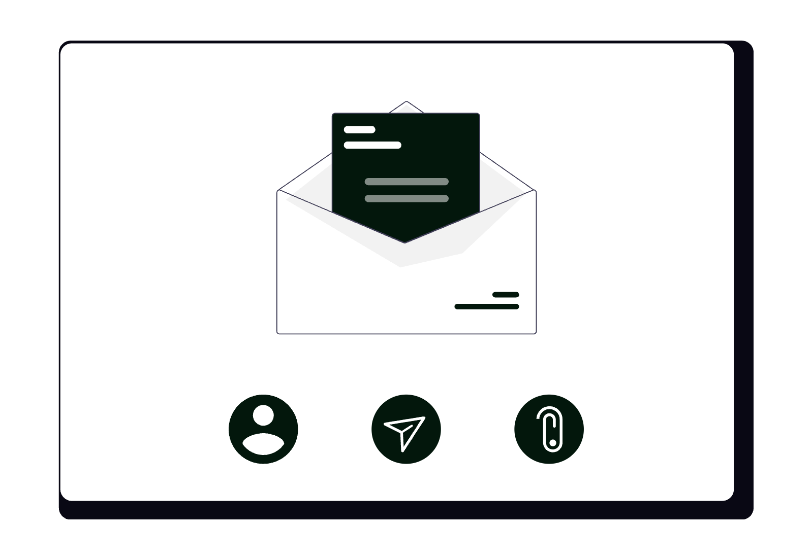
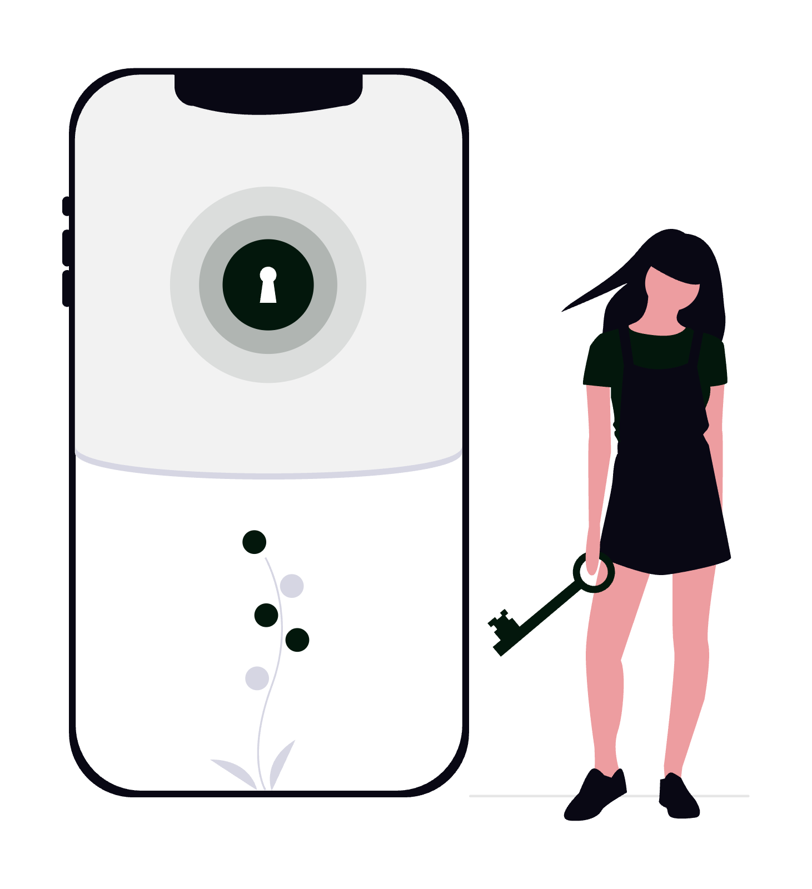

# Domeniu și email profesional pentru cabinet: al cui e, de fapt?

Adresa cabinetului tău de e-mail poate fi un cont @gmail.com deschis acum zece ani, iar domeniul website-ului poate fi înregistrat pe numele unui nepot, al unui fost colaborator sau al agenției care l-a făcut. Cât timp totul merge, nimeni nu se uită. Problema apare când vrei să schimbi furnizorul, când domeniul expiră sau când omul care are parola nu mai răspunde la telefon. Mai jos vezi cum verifici, concret, al cui este fiecare piesă și ce pași faci ca ele să rămână sub controlul cabinetului.

  

    
  

## 1. Trei lucruri diferite: domeniul, găzduirea și e-mailul

Când spui „website-ul cabinetului”, vorbești de fapt despre trei servicii separate, care pot fi la furnizori diferiți:

| Piesa | Ce este | Întrebarea de control |
|---|---|---|
| **Domeniul** | Numele, de exemplu `cabinet-exemplu.ro` | Pe numele cui este înregistrat? |
| **Găzduirea (hosting)** | Serverul unde stau fișierele website-ului | Cine are contul și cine plătește? |
| **E-mailul** | Serviciul care primește și trimite mesajele `@cabinet-exemplu.ro` | Cine este administratorul contului? |

Peste toate stă **DNS-ul**: setările domeniului care spun unde se deschide website-ul și unde ajung e-mailurile. Cine controlează DNS-ul poate muta oricând website-ul sau e-mailul, fără să atingă celelalte servicii.

Fiecare piesă are propriul cont, propria parolă și propriul titular. Faptul că plătești factura nu înseamnă automat că ești titularul.

## 2. Ce înseamnă „al cui e” un domeniu `.ro`

Pentru domeniile `.ro`, registrul național este RoTLD. Tehnic, nu „cumperi” un domeniu, ci obții un drept de folosință asupra lui, pentru o perioadă pe care o reînnoiești. Persoana sau entitatea înregistrată ca **deținător** este cea care decide ce se întâmplă cu domeniul.

Asta contează în trei situații:

- când vrei să muți domeniul la alt furnizor;
- când vrei să schimbi deținătorul;
- când apare o dispută despre cine are dreptul să folosească numele.

În toate trei, contează cine apare ca deținător, nu cine a plătit și nici cine l-a configurat.

## 3. Cum verifici deținătorul unui domeniu `.ro`

Primul pas este căutarea **WHOIS** pe [rotld.ro](https://www.rotld.ro/). Aici apare o limită importantă: potrivit RoTLD, datele deținătorului se afișează doar când acesta este persoană juridică. Dacă deținătorul este persoană fizică, datele nu apar public, conform GDPR ([explicația RoTLD](https://rotld.ro/blog/can-the-data-on-a-holder-be-required-to-not-be-displayed-in-the-rotld-national-registry-database/)).

Asta înseamnă că din WHOIS afli de obicei data înregistrării, data expirării, furnizorul (registrarul) și serverele DNS, dar nu întotdeauna numele deținătorului. Ca să afli exact:

1. Cauți domeniul în WHOIS pe rotld.ro și notezi registrarul și data expirării.
2. Ceri în scris furnizorului care ți-a înregistrat domeniul numele deținătorului și adresa de e-mail asociată domeniului.
3. Verifici dacă ai acces la contul de administrare al domeniului (la registrar sau în interfața **Administrare Online** de pe rotld.ro).

Pentru domeniile `.com`, `.eu` sau altele, regulile de afișare diferă de la registru la registru. Principiul rămâne același: ceri în scris furnizorului datele deținătorului și accesul la contul domeniului.

## 4. Când domeniul este pe numele altcuiva

Un domeniu înregistrat pe numele nepotului, al unui fost asociat sau al unei agenții funcționează perfect până în ziua în care ai nevoie de el.

Procedura RoTLD de [transfer al dreptului de folosință](https://www.rotld.ro/procedura-de-transfer-drept-de-folosinta/) arată de ce. Ca deținătorul să se schimbe, deținătorul actual generează o **cheie de autorizare**, pe care RoTLD o trimite automat pe adresa de e-mail a deținătorului. Abia cu această cheie noul deținător poate completa formularul de transfer. Procedura se face cu acordul ambelor părți și este un serviciu contra cost.

Concret, dacă deținătorul nu colaborează sau nu mai are acces la adresa de e-mail asociată domeniului, schimbarea devine complicată. Nu este o problemă juridică abstractă: e adresa la care ajunge e-mailul cabinetului și numele pe care l-ai tipărit pe cărțile de vizită.

Mai există un risc: **expirarea**. Dacă reînnoirea se face pe cardul altcuiva sau notificările ajung la o adresă pe care nu o citește nimeni, domeniul poate expira fără să afli la timp.

## 5. Adresa @gmail.com: ce câștigi și ce pierzi

Un cont @gmail.com personal este gratuit, cunoscut și funcționează bine. Pentru un cabinet are însă câteva limite:

- Adresa nu se leagă de numele cabinetului, ci de un serviciu gratuit folosit de oricine.
- Contul este personal. Poți delega accesul altui cont Gmail, dar nu poți crea, sub numele cabinetului, adrese separate pentru colaboratori sau secretariat.
- Dacă vrei să schimbi furnizorul de e-mail, adresa nu vine cu tine. Toți clienții și instanțele trebuie anunțați de noua adresă.

Un e-mail pe domeniul propriu, de tipul `nume@cabinet-exemplu.ro`, rezolvă ultimul punct: adresa rămâne a ta, chiar dacă schimbi furnizorul care o găzduiește. Despre cum lucrezi eficient în fiecare variantă găsești ghidurile [Cum să folosești Gmail ca avocat](../cum-sa-folosesti-gmail-ca-avocat/) și [Cum să folosești Outlook ca avocat](../cum-sa-folosesti-outlook-ca-avocat/).

## 6. Contul de administrator al e-mailului

Dacă folosești e-mail pe domeniu prin Google Workspace sau Microsoft 365, există un **cont de administrator**. Din el se creează și se șterg adrese, se resetează parole, se schimbă setările de securitate și, în funcție de configurare, se poate accesa conținutul căsuțelor.

Asta are o consecință directă pentru un avocat. Corespondența cu clienții este acoperită de secretul profesional, potrivit Legii nr. 51/1995. Dacă o altă persoană are acces de administrator la e-mailul cabinetului, verifică exact ce poate vedea și dacă există un contract care acoperă acest acces.

Întrebările de pus:

- Cine este administratorul principal al contului de e-mail?
- Pe ce adresă se trimit codurile de recuperare și alertele de securitate?
- Câte conturi au drepturi de administrator și ale cui sunt?
- Există un contract de prelucrare a datelor cu cel care administrează contul, dacă nu ești tu?

## 7. Adresa de contact a domeniului: cheia tuturor celorlalte

Toate drumurile duc la o singură adresă de e-mail: cea asociată domeniului și conturilor de administrare. Pe ea ajung cheia de autorizare RoTLD, notificările de expirare, resetările de parolă și alertele de securitate.

Dacă adresa aceasta aparține fostei agenții sau unei persoane din afara cabinetului, controlul real e la acea persoană, oricine ar apărea în acte. Pune pe lista de verificare și această întrebare: adresa de contact a domeniului este una pe care o citești tu?

  

    
  

## 8. Cum muți e-mailul pe domeniul cabinetului

Pașii, în ordine:

1. **Verifici domeniul**: deținătorul, data expirării și accesul la contul de administrare (secțiunile 3 și 4).
2. **Alegi serviciul de e-mail**: de exemplu Google Workspace sau Microsoft 365. Contul de administrator îl creezi pe numele cabinetului, cu o adresă de recuperare pe care o controlezi.
3. **Creezi adresele**: una principală pentru tine și, la nevoie, adrese separate pentru colaboratori sau secretariat, fiecare cu propria parolă.
4. **Schimbi înregistrările DNS**: înregistrările **MX** trimit e-mailurile către noul serviciu. Furnizorul de e-mail îți dă valorile exacte.
5. **Configurezi autentificarea**: SPF, DKIM și DMARC (secțiunea 9).
6. **Muți corespondența veche**: ambele servicii mari au instrumente de import din alte conturi.
7. **Anunți noua adresă**: clienții, instanțele, baroul, semnătura de e-mail, website-ul, profilul Google Business.
8. **Păstrezi vechea adresă o perioadă**, cu redirecționare sau cu un răspuns automat, ca să nu pierzi mesaje.

## 9. SPF, DKIM și DMARC, pe scurt

Sunt trei înregistrări DNS care le arată serverelor de e-mail că mesajele trimise de pe domeniul tău sunt autentice:

- **SPF** spune ce servere au voie să trimită e-mail în numele domeniului.
- **DKIM** adaugă o semnătură digitală fiecărui mesaj.
- **DMARC** spune ce se întâmplă cu mesajele care nu trec de verificări.

Din 1 februarie 2024, Google cere ca toți expeditorii către conturi Gmail să aibă configurat cel puțin SPF sau DKIM, iar cei care trimit peste 5.000 de mesaje pe zi să aibă SPF, DKIM și DMARC ([regulile Google pentru expeditori](https://support.google.com/a/answer/81126?hl=ro)). Google recomandă configurarea tuturor trei pentru orice domeniu. Fără ele, mesajele tale către clienți pot ajunge în spam sau pot fi respinse.

## 10. Numele domeniului și regulile profesiei

Când alegi sau schimbi domeniul, ține cont și de regulile de publicitate ale profesiei. Există reguli despre ce poate conține numele de domeniu al unui avocat. Le găsești explicate, cu trimiteri la textele aplicabile, în ghidul [ce are voie un avocat să publice online](../ce-are-voie-avocat-sa-publice-online/).

Dacă ai deja un domeniu, verifică-l cu aceleași reguli înainte să investești în el. E mai ușor să schimbi numele acum decât după ce l-ai tipărit pe toate actele.

## 11. Ce ceri în scris oricărui furnizor

Indiferent cu cine lucrezi pentru domeniu, website sau e-mail, ceri în scris răspunsul la câteva întrebări simple:

- Pe numele cui este înregistrat domeniul?
- Ce adresă de e-mail este asociată domeniului?
- Cine are contul de administrare al domeniului, al găzduirii și al e-mailului?
- Am și eu acces de administrator? Dacă nu, de ce nu?
- Ce se întâmplă cu domeniul, cu website-ul și cu e-mailul dacă nu mai lucrăm împreună?
- Cine plătește reînnoirea și cine primește notificările de expirare?

Un furnizor serios îți răspunde fără ezitare. Dacă răspunsurile sunt vagi, ai aflat deja ce trebuie să schimbi. Pentru tot ce ține de întreținerea regulată a website-ului, vezi și ghidul despre [mentenanța website-ului pentru avocați](../mentenanta-site-avocati/), iar pentru costurile tipice, [cât costă un website de avocat în 2026](../cat-costa-un-site-de-avocat-in-2026/).

## 12. Checklist

- Știi pe numele cui este înregistrat domeniul.
- Adresa de e-mail asociată domeniului este una pe care o citești tu.
- Ai acces la contul de administrare al domeniului.
- Știi data expirării și cine plătește reînnoirea.
- Ai acces de administrator la serviciul de e-mail.
- Codurile de recuperare ajung la o adresă și la un telefon pe care le controlezi.
- Fiecare colaborator are propriul cont, nu o parolă comună.
- SPF, DKIM și DMARC sunt configurate pe domeniu.
- Ai în scris, de la furnizor, ce se întâmplă cu domeniul și e-mailul la încheierea colaborării.
- Ai verificat numele domeniului cu regulile de publicitate ale profesiei.

## Întrebări frecvente

### Cum aflu pe numele cui este domeniul .ro al cabinetului?

Cauți domeniul în WHOIS pe rotld.ro. Datele deținătorului apar doar dacă acesta este persoană juridică; pentru persoane fizice nu se afișează. În acest caz, ceri în scris furnizorului numele deținătorului și adresa de e-mail asociată domeniului.

### Ce se întâmplă dacă domeniul este pe numele altcuiva?

Pentru un domeniu .ro, schimbarea deținătorului se face prin procedura RoTLD de transfer al dreptului de folosință, cu acordul ambelor părți. Deținătorul actual generează o cheie de autorizare, trimisă pe adresa lui de e-mail, iar noul deținător o folosește în formularul de transfer. Fără colaborarea deținătorului, schimbarea devine complicată.

### Este o problemă dacă folosesc o adresă @gmail.com pentru cabinet?

Nu este interzis, dar adresa nu este legată de numele cabinetului și nu o poți păstra dacă schimbi furnizorul de e-mail. Un e-mail pe domeniul propriu rămâne al tău chiar dacă muți serviciul care îl găzduiește.

### Ce sunt SPF, DKIM și DMARC și chiar îmi trebuie?

Sunt înregistrări DNS care arată că mesajele trimise de pe domeniul tău sunt autentice. Din 1 februarie 2024, Google cere ca toți expeditorii către conturi Gmail să aibă cel puțin SPF sau DKIM și recomandă configurarea tuturor trei. Fără ele, mesajele pot ajunge în spam sau pot fi respinse.

### Ce întreb furnizorul înainte să semnez?

Pe numele cui se înregistrează domeniul, ce adresă de e-mail i se asociază, cine are contul de administrare al domeniului, al găzduirii și al e-mailului, dacă primești și tu acces de administrator și ce se întâmplă cu toate acestea la încheierea colaborării. Ceri răspunsurile în scris.

## Concluzie

Domeniul, găzduirea și e-mailul sunt trei servicii diferite, fiecare cu titularul și administratorul lui. Verificarea durează puțin: WHOIS pe rotld.ro, câteva întrebări puse în scris furnizorului și un control al conturilor de administrator. Mutarea e-mailului pe domeniul cabinetului cere ceva mai mult timp, dar o faci o singură dată.

Limita este că nu poți rezolva totul singur. Dacă domeniul este pe numele altcuiva, ai nevoie de colaborarea acelei persoane, iar procedura de transfer are pașii și costurile ei.

Dacă dorești să verifici sau să configurezi domeniul și e-mailul profesional al cabinetului tău, cu autentificare SPF, DKIM și DMARC, echipa **SOLON** oferă consultanță de digitalizare adaptată specificului practicii tale juridice.

---

> *Prezentul articol are un caracter pur informativ și educațional și nu constituie consultanță juridică în sensul Legii nr. 51/1995. Pentru o situație concretă, consultă un avocat.*
>
> *Articol redactat cu asistență AI, verificat și asumat editorial de echipa SOLON.*
