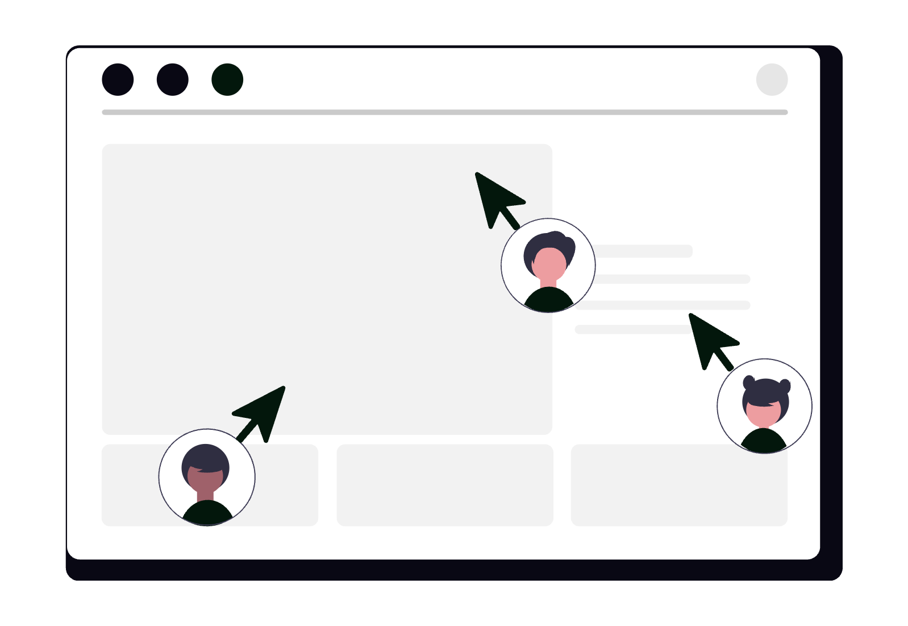

# Fotografia profesională pentru avocați: ghid de ședință foto

Poza de pe website este adesea un decupaj de la o nuntă, fotografia de pe Google este din alt an, iar pe LinkedIn apare alt om sau nimeni. Cine te caută compară cele trei fără să îți spună. O ședință de o oră îți dă un set pe care îl poți folosi la fel peste tot: portret, echipă, birou și câteva cadre „la lucru”, fără clienți și fără dosare în cadru.

  

    
  

## 1. Patru fotografii, nu una singură

Un portret bun nu acoperă pagina de contact și nici profilul Google. Îți trebuie patru tipuri, făcute în aceeași zi, ca lumina și hainele să se potrivească.

| Cadrul | Ce se vede | Unde îl folosești întâi |
|---|---|---|
| **Portret** | Fața, umerii, un fundal liniștit | Pagina de prezentare, Google, LinkedIn |
| **Echipă** | Oamenii care chiar lucrează în cabinet și au fost de acord | Pagina despre noi |
| **Birou** | Sala de întâlniri, recepția, fațada dacă acolo primești lumea | Pagina de contact, coperta de pe Google |
| **La lucru** | Tu la birou, cu un caiet sau o carte, fără dosar deschis | O pagină de arie sau prezentarea cabinetului |

Dacă ești singur în cabinet, sari peste fotografia de echipă. Nu aduce un prieten „să se vadă mai mulți oameni”. Cadrul trebuie să descrie practica, nu o distribuție.

## 2. Portretul

Portretul este poza care rămâne când cineva reține o singură imagine. Se vede fața, umerii și puțin spațiu deasupra capului. Privirea este spre obiectiv. Lumina vine din față. O fereastră în spate te lasă siluetă, iar pe un ecran mic silueta nu are chip.

Lasă loc în jurul feței. LinkedIn taie cercul, iar fotografia de profil din Google este pătrată. Dacă ești lipit de marginea cadrului, decupajul îți taie fruntea.

Poartă ochelarii pe care îi porți la întâlniri. Dacă te-ai schimbat vizibil de la ultima poză, barba, ochelarii, părul, refaci portretul. O poză din urmă cu opt ani nu este „suficient de bună” doar pentru că era profesională atunci.

Nu zâmbi pentru reclamă și nu sta rigid ca la buletin. Expresia de la o discuție obișnuită se citește mai clar decât o grimasă ținută cinci secunde.

## 3. Echipa

În fotografia de echipă intră doar oamenii care vor apărea și pe website, cu numele lor. Aceeași lumină, același fundal, haine din aceeași familie de culori.

O poză în care se vede fața fiecăruia, nu doar siluete pe un hol.

Anunță ședința din timp. Cine nu vrea să apară nu stă „doar la margine, că oricum nu se vede”. Dacă se vede, este în fotografie.

Colegii care au plecat ies din pagină odată cu plecarea. Păstrează fișierul, nu publicația. O pagină „echipa” cu oameni care nu mai sunt acolo spune o poveste care nu mai este adevărată.

## 4. Biroul

Fotografia de birou arată unde te găsește omul, dacă primești la sediu. Trei cadre ajung: fațada sau intrarea, sala de întâlniri goală și recepția, dacă ai una.

Sala goală nu este o sală tristă. Este o sală în care nu se vede dosarul nimănui. Măsuța are o cană, o plantă, un blocnotes închis. Nu are mape, nu are un laptop cu un nume pe ecran, nu are un tabel cu programări.

Dacă lucrezi de acasă sau dintr-un spațiu pe care îl împarți și nu primești clienți acolo, nu fotografia dormitorul ca să ai „un sediu”. Portretul și cadrul la birou, cu un fundal neutru, sunt de ajuns. Adresa publică rămâne cea pe care chiar o folosești, aceeași cu [profilul Google](../google-business-profile-avocati/).

## 5. Cadrul „la lucru”

„La lucru” înseamnă că ești în meserie, nu că arăți un mandat. Stai la birou, cu o carte deschisă la o pagină fără nume, sau cu un caiet gol.

Vorbești cu un coleg care a fost de acord să fie în cadru. Nu întinzi un dosar spre cameră.

Ecranul este stins sau arată o pagină goală. Tabla este ștearsă. Etichetele de pe bibliorafturi sunt întoarse sau sunt etichete generice, de felul „bibliotecă”, nu numele unei părți.

Nu fotografia o ședință de judecată, o consultație sau holul unei instituții plin de oameni. Nu controlezi cine intră în cadru și nu ai acordul lor.

## 6. Cum te pregătești

Ședința durează puțin dacă lista de cadre există dinainte. Trimite fotografului, cu o zi înainte, cele patru tipuri de mai sus și camerele în care vrei să lucrați.

Seara dinainte:

- strângi dosarele de pe birouri, nu în ultimele zece minute;
- stingi sau golești ecranele;
- ștergi tabla;
- întorci registrele și agendele cu programări;
- scoți de pe perete ce nu vrei să se citească într-o fotografie mărită, diplome cu date inutile, notițe, un calendar cu nume.

În dimineața ședinței, colegii știu la ce oră sunt chemați și că pot refuza cadrul. Ai un al doilea set de haine. Ai o batistă pentru ochelari. Nu îți programezi un client în ora aceea. Dacă sună cineva, nu intră în cadru „pentru un minut”.

Cere de la fotograf fișierul mare, nu doar o previzualizare trimisă pe telefon. Din fișierul mare faci decupajul pătrat și pe cel pentru cerc.

  

    
  

## 7. Ce porți

Hainele din portret sunt hainele în care primești un client. Culori liniștite, fără imprimeu mărunt, care se strică pe un ecran. Fără logo mare pe piept. Cămașa să fie călcată. Un al doilea set te scapă dacă primul se șifonează între cadre.

Roba nu este uniforma portretului. La dimensiunea unui avatar se citește greu și leagă poza de un singur context. O poți face într-un cadru separat, dacă o folosești undeva anume. Portretul principal rămâne cel în care ți se vede fața clar, în hainele de fiecare zi profesională.

Bijuteriile zgomotoase și ochelarii de soare rămân acasă. Dacă porți ochelari de vedere, rămân pe nas.

## 8. Ce eviți

Decupajul de la nuntă este exemplul cel mai des. Fundalul este o sală, haina este de eveniment, lângă tine era cineva pe care l-ai tăiat din cadru.

Pe website arată ca o poză luată din alt album. La fel vacanța, petrecerea firmei și fotografia de buletin, mărită până se sparge.

Nu pune o fotografie de stoc cu „un avocat” care nu ești tu. Omul care te sună se așteaptă să te recunoască.

Nu prezenta un portret generat de un model ca și cum ai fi tu. Dacă publici o imagine generată care poate fi luată drept o persoană reală, Regulamentul privind inteligența artificială, art. 50, cere să se știe că este generată. Un chip generat tot nu ești tu. Ilustrațiile din acest articol sunt desene, nu fotografii ale unui avocat.

Filtrele care îți schimbă fața, pielea, vârsta, au aceeași problemă practică: nu te mai recunoaște omul de la ușă.

## 9. Oamenii din cadru

Chipul unei persoane care poate fi recunoscută este o dată cu caracter personal. Art. 4 pct. 1 din Regulamentul (UE) 2016/679 definește data prin raportare la o persoană identificată sau identificabilă. Art. 73 din Codul civil spune că orice persoană are dreptul la propria imagine și poate să se opună reproducerii înfățișării sale sau folosirii acelei reproduceri.

Pentru o fotografie pe care o publici tu, regula practică este un acord scris, înainte de publicare, nu după ce poza este deja pe website. În bilet scrii:

- cine apare;
- cine publică (cabinetul);
- canalele: website-ul, Google Business Profile, LinkedIn;
- că persoana poate cere retragerea de pe canalele pe care le controlezi.

Comisia Europeană explică faptul că un consimțământ nu este liber când există un dezechilibru clar între persoană și organizație, iar exemplul dat este relația angajator-angajat. Un „da” spus pe hol de un colaborator, ca să nu încurce ședința, este un acord fragil.

Nu condiționa colaborarea de apariția în poză. Pentru temeiul prelucrării în situația ta, întreabă un specialist. Acest text nu îl alege și nu ține loc de informare GDPR.

Art. 76 din Codul civil prezumă consimțământul doar când persoana însăși dă materialul cuiva despre care știe că informează publicul. O ședință pe care ai organizat-o tu nu este cazul acela. Nu te baza pe prezumție.

Art. 89 alin. (1) din Legea nr. 8/1996, republicată, spune că utilizarea unei opere care conține un portret cere consimțământul persoanei reprezentate, în condițiile art. 73, 74 și 79 din Codul civil. Alineatul (2) prevede că, în lipsa unei clauze contrare, consimțământul nu este necesar dacă persoana este model de profesie sau a fost plătită ca să pozeze pentru acel portret. Un coleg de cabinet nu este model de profesie. O sumă dată „pentru poză” nu îți spune pe ce canale ai voie să publici și nu răspunde la întrebarea despre date. Canalul și retragerea rămân scrise.

Ce ai voie să spui lângă fotografie, titulatură, arii, formulări, stă în ghidul despre [ce are voie un avocat să publice online](../ce-are-voie-avocat-sa-publice-online/). Poza nu ocolește regulile de publicitate doar pentru că este imagine, nu paragraf.

## 10. Clienți, dosare și alte persoane

Clienții nu intră în ședința de prezentare. Nici părțile adverse, nici persoanele din sala de așteptare, nici curierul care a nimerit în cadru. Un acord verbal, între două discuții, nu îți lasă o listă de canale și poate fi retras a doua zi, când fotografia este deja pe trei pagini.

Un chip lângă un dosar poate identifica un mandat chiar dacă nu spui numele. De aceea cadrul „la lucru” se face cu caietul închis sau cu o carte fără nume de părți, nu cu mapa de pe birou.

Verifici fiecare cadru înainte să îl trimiți mai departe:

- niciun ecran cu text;
- nicio foaie cu un nume, un CNP, o adresă sau numărul unui dosar;
- nicio ecuson de vizitator;
- nicio persoană în fundal pe care nu ai pus-o tu în listă;
- nicio firmă de corespondență deschisă pe masă.

Dacă un cadru nu trece lista, nu îl „decupezi un pic”. Îl lași nepublicat.

## 11. Aceeași fotografie, pe trei canale

Alegi un portret principal și îl folosești pe website, pe Google și pe LinkedIn. Oamenii te caută pe rând. Trei vârste, trei tunsori sau trei persoane diferite par trei cabinete.

Pe website, portretul stă în pagina de prezentare, biroul stă la contact, echipa stă la „despre”, doar cu oamenii actuali. Regulile de fond, de decupaj și de care poză este cea principală țin de [manualul de brand](../ce-este-un-manual-de-brand-pentru-avocati/). Le scrii o dată, nu le reiei la fiecare rețea.

Pe Google Business Profile, același portret este fotografia de profil, iar biroul poate fi coperta. Pașii profilului sunt în [checklistul pentru avocați](../google-business-profile-avocati/). Nu urca aici o poză pe care nu o ai și pe website.

Pe LinkedIn, același portret. Cercul taie colțurile, de aceea spațiul din jurul feței contează. Cum se completează restul profilului este în ghidul [Cum să folosești LinkedIn ca avocat](../cum-sa-folosesti-linkedin-ca-avocat/).

Nu refaci ședința ca să prinzi o modă vizuală. Un portret clar ține mai mult decât un fundal la modă. Ce se schimbă în brandingul profesioniștilor din juridic este discutat în [tendințele de branding](../tendinte-actuale-branding-profesionisti-juridic/). Portretul nu trebuie să alerge după ele.

Dacă înregistrezi și un video scurt, stai în aceleași haine și în aceeași lumină. Omul din film este omul din poză. Altfel ai iar două versiuni.

## 12. Checklist

- Ai portret, birou și, dacă e cazul, echipă și un cadru „la lucru”, din aceeași ședință.
- Portretul are loc în jurul feței, pentru decupajul pătrat și pentru cerc.
- În cadru nu este niciun client, nicio parte și nicio persoană întâmplătoare.
- Dosarele, ecranele, tablele și agendele cu nume sunt în afara cadrului.
- Fiecare coleg din poză are un acord scris, cu canalele și cu posibilitatea de retragere.
- Ai de la fotograf, în scris, dreptul de folosire pe website, Google și LinkedIn, plus fișierele.
- Aceeași față este pe website, pe profilul Google și pe LinkedIn.
- Legenda nu promite rezultate și nu îți atribuie un titlu pe care nu îl ai.
- Pozele colegilor care au plecat nu mai stau pe pagină.
- Nu ai publicat un decupaj de la nuntă, din vacanță sau un chip generat prezentat ca fiind tu.

## Întrebări frecvente

### Pot folosi o fotografie de la o nuntă sau din vacanță?

Poți decupa o față dintr-o fotografie de familie, dar fundalul, hainele și momentul nu sunt ale cabinetului. Pe website, pe Google și pe LinkedIn se citește ca o poză luată din alt context. O ședință scurtă îți dă un portret pe care îl poți folosi fără să explici de unde vine.

### Am nevoie de acordul colegilor din fotografia de echipă?

Da, ca regulă practică. Chipul unei persoane este o dată cu caracter personal, iar Codul civil îi recunoaște dreptul la propria imagine. Spune în scris unde va apărea fotografia, pe website, pe Google Business Profile și pe LinkedIn, și că o poți retrage de pe canalele pe care le controlezi. Un da pe hol, între angajator și colaborator, este un acord fragil. Pentru temeiul exact al prelucrării, întreabă un specialist. Acest articol nu îl alege.

### Pot fotografia un client dacă îmi spune că este de acord?

Nu o face pentru materialele de prezentare ale cabinetului. Un acord verbal, în birou, nu îți lasă o evidență clară a canalelor, iar fața împreună cu un dosar poate identifica un mandat. Clienții, părțile adverse și persoanele venite la consultație rămân în afara cadrului.

### Cine poate publica fotografiile după ședință?

Fotograful este autorul fotografiei. Înainte de ședință, cere în scris dreptul de a folosi imaginile pe website, pe Google Business Profile și pe LinkedIn, inclusiv decupajele, și cere fișierele. Acordul fotografului nu înlocuiește acordul persoanelor din cadru. Art. 89 din Legea nr. 8/1996, republicată, cere consimțământul persoanei dintr-un portret, în condițiile Codului civil.

### Trebuie fotografii diferite pe website, Google și LinkedIn?

Nu. Aceeași persoană, din aceeași ședință, pe toate trei. LinkedIn decupează rotund, iar profilul Google folosește un cadru pătrat, deci lași spațiu în jurul feței. Schimbi decupajul, nu identitatea.

## Concluzie

O ședință bună nu este un album. Este un portret pe care te recunoaște omul, un birou fără dosare în cadru și, dacă lucrezi cu alții, o echipă care a știut unde va apărea poza. Aceleași fișiere merg pe website, pe Google și pe LinkedIn. Schimbi decupajul, nu persoana.

Limita este de întreținere și de acord. Pozele se învechesc când te schimbi tu sau când pleacă un coleg. Un acord poate fi retras, deci ai nevoie de o cale simplă să scoți fotografia de pe canalele pe care le controlezi. Iar textul de lângă poză rămâne supus regulilor de publicitate ale profesiei.

Dacă dorești o ședință foto și un set coerent de imagini pentru website-ul cabinetului, pentru profilul Google și pentru LinkedIn, echipa **SOLON** oferă consultanță de digitalizare adaptată specificului practicii tale juridice.

---

> *Prezentul articol are un caracter pur informativ și educațional și nu constituie consultanță juridică în sensul Legii nr. 51/1995. Pentru o situație concretă, consultă un avocat.*
>
> *Articol redactat cu asistență AI, verificat și asumat editorial de echipa SOLON.*
