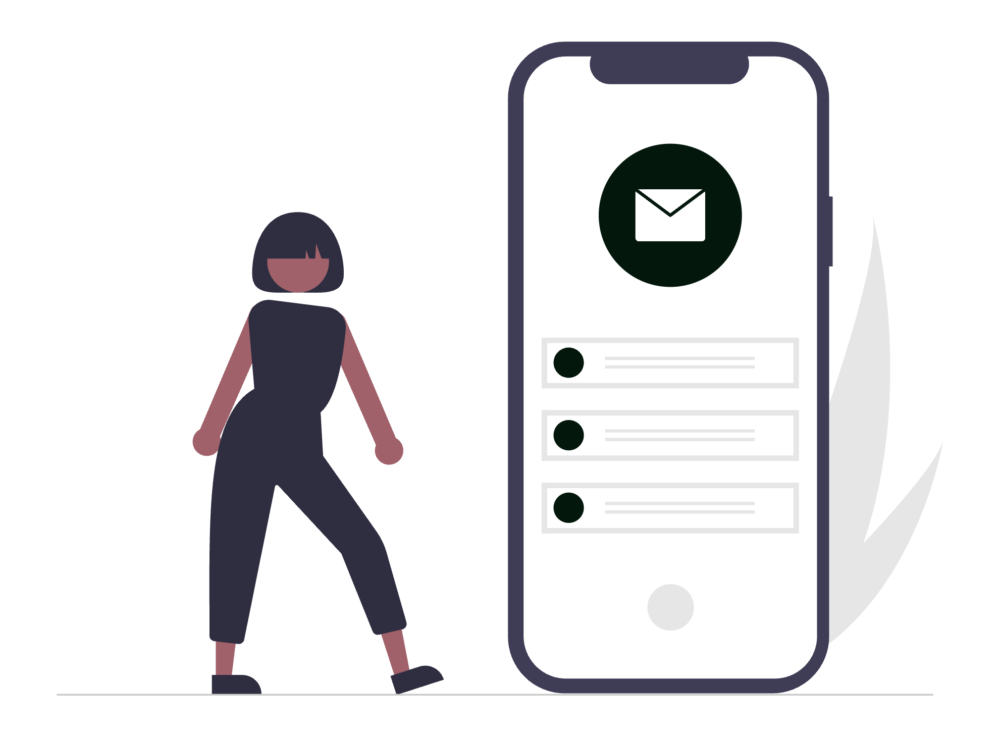

# Instagram și Facebook pentru avocați: ce formate funcționează

Prezența pe LinkedIn este bine stabilită în rândul avocaților, dar Instagram și Facebook ajung la un public mai larg: persoane fizice care caută ajutor juridic pentru probleme de familie, conflicte civile sau spețe penale. Diferența față de o rețea profesională este că aceste platforme consumă conținut vizual și rapid, iar dacă știi ce formate să folosești, cabinetul tău poate deveni o resursă de încredere fără să depășești limitele impuse de deontologie. Ghidul de față completează sfaturile despre [LinkedIn ca avocat](../cum-sa-folosesti-linkedin-ca-avocat/) și se concentrează pe tactici concrete, adaptate regulilor profesiei.

  

    
  

*Actualizat: octombrie 2026.*

**Acest material are caracter informativ și nu constituie consultanță juridică.** Este realizat de SOLON, agenția digitală pentru avocați din România. Nu înlocuiește textul actelor normative și nici îndrumarea baroului din care faci parte.

## 1. De ce Instagram și Facebook, pe lângă LinkedIn

LinkedIn funcționează excelent pentru networking cu alți avocați, cu antreprenori și cu firme. Instagram și Facebook completează imaginea cu un public mai divers: persoane fizice care caută un avocat pentru o dispută de vecinătate, o procedură de divorț sau un dosar penal.

Cele două platforme permit formate diverse - video scurt, carusel, Stories -, potrivite pentru explicații vizuale și rapide. Facebook păstrează o bază mare de utilizatori în România, iar Instagram are o audiență care interacționează activ cu conținut educativ scurt.

Ambele platforme sunt gestionate prin aceeași suită Meta Business Suite, ceea ce simplifică publicarea simultană.

Un ghid cu regulile deontologice complete pentru publicitate online este disponibil la [ce are voie un avocat să publice online](../ce-are-voie-avocat-sa-publice-online/).

## 2. Formate care funcționează pentru un cabinet de avocatură

### Carouseluri cu explicații scurte de drept

Formatul carusel (2-10 slide-uri, raport 1:1 sau 4:5, rezoluție recomandată 1.080×1.080 px sau 1.080×1.350 px, conform centrului de ajutor Meta) funcționează bine pentru concepte juridice cu mai multe etape sau fațete.

Structura care funcționează:
- **Slide 1**: titlul subiectului sau o întrebare la care răspunzi
- **Slide 2-6**: câte un punct principal per slide - definiție, condiții, excepții, exemple generice
- **Slide final**: un îndemn clar: „Citește articolul complet” sau „Programează o consultanță”

Exemple de subiecte: ce înseamnă un executor judecătoresc și ce poate face, pașii unui divorț prin acord, diferența dintre contract de muncă și contract de prestări servicii. Folosește termeni clari, fără jargon inutil, și verifică fiecare afirmație juridică înainte de publicare.

### „Mituri juridice”

Formatul constă în a expune un mit comun și a-l corecta printr-o explicație scurtă și sursă. Funcționează ca un carusel de 3 slide-uri sau ca un Reel de 30-45 secunde cu text suprapus.

Structura:
- **Slide 1 / primele secunde**: mitul formulat ca afirmație („Poți fi dat în judecată dacă nu ai semnat nimic”)
- **Slide 2 / miezul**: realitatea juridică, explicată simplu
- **Slide 3 / final**: sfatul practic sau trimite la un articol mai detaliat de pe websiteul cabinetului

Subiectele aleg priorități reale ale publicului, nu neapărat spețele preferate ale avocaților.

### Reel-uri educaționale

Reels-urile sunt video-uri verticale, raport 9:16, rezoluție minimă recomandată 1.080×1.920 px, cu durata cuprinsă între 15 și 90 de secunde pe Instagram și Facebook (Meta, centrul de ajutor oficial pentru Reels). Subtitrarea este esențială: o mare parte din vizionări au loc fără sunet.

Ce funcționează în format Reel:
- Explicarea unui drept pe care mulți nu îl știu (ex: dreptul la tăcere în proceduri administrative)
- Un proces simplu pas cu pas (ex: cum obții un extras de carte funciară)
- Clarificarea unui termen care apare frecvent în presă

Tonul rămâne educativ, nu persuasiv. Nu promite rezultate. Nu dai cifre de succes.

### Behind the scenes

Stories și Reels scurte (15-30 secunde) cu biblioteca cabinetului, masa de lucru înainte de o zi de audieri sau sala de conferințe umanizează cabinetul fără să dezvăluie date din dosare.

Regula de bază: niciun element din cadru nu trebuie să permită identificarea unui client sau a unui dosar. Verifică dacă documentele de pe birou, ecranele laptopului sau tabelele afișate în fundal sunt ascunse sau complet neclare.

## 3. Ce să nu postezi: regulile deontologice aplicate pe social media

Pct. 8 din Anexa XXXIV la Statutul profesiei de avocat precizează că regulile de publicitate se aplică identic și online. Nu există excepții pentru Instagram sau Facebook.

**Interzis pe orice platformă:**

- Promisiuni de rezultat sau procente de succes - inclusiv implicit (ex: „Dosarul a durat doar 3 luni”)
- Numele, fotografia sau orice element care identifică un client (Statut, Anexa XXXIV, pct. 3.1 lit. c; Codul deontologic al avocatului român, art. 20 alin. 7)
- Mențiunile privind rezultatele obținute, cifra de afaceri sau numărul de dosare (Codul deontologic, art. 20 alin. 6)
- Comparații sau afirmații denigratoare la adresa altor avocați sau firme de avocatură (Statut, art. 243¹ alin. 2)
- Mesaje comerciale nesolicitate trimise direct potențialilor clienți (Statut, Anexa XXXIV, pct. 3.2 lit. a)

**Testimonialele și recenziile clienților sunt o zonă deontologic problematică.** Preluarea recenziilor sau a citatelor din mesajele clienților în propria publicitate poate dezvălui identitatea clientului, relația de mandat sau rezultatele obținute - toate aspecte interzise de Statut, Anexa XXXIV, pct. 3.1 lit. c și de Codul deontologic, art. 20 alin. 6-7. Recenziile spontane pe platforme terțe nu pot fi interzise de avocat, dar răspunsul la ele nu poate conține informații din dosar (Legea nr. 51/1995, art. 11 privind secretul profesional). Înainte de orice formă de testimonial publicitar, consultă baroul din care faci parte.

Alte interdicții practice le găsești rezumate în ghidul detaliat [ce are voie un avocat să publice online](../ce-are-voie-avocat-sa-publice-online/).

## 4. Frecvență realistă

Nu ai nevoie de postare zilnică. Un ritm sustenabil pentru un cabinet individual sau de dimensiuni mici:

- **Facebook**: 2-3 postări pe săptămână - un articol de blog redistribuit, o infografică sau un Reel
- **Instagram**: 1-2 postări pe feed și câteva Stories pe săptămână

Constanța bate volumul. Un profil actualizat regulat transmite mai multă credibilitate decât o campanie intensă de două săptămâni urmată de inactivitate. Planifică o lună de postări dintr-o singură sesiune de două ore și folosește Meta Business Suite pentru programare.

## 5. Cum refolosești articolele de blog pe social media

Un articol de blog bine structurat este materie primă pentru social media. Un text de 1.500 de cuvinte poate genera:

- **1 carusel** cu 5-6 idei principale (un titlu H2 per slide)
- **1 Reel de 60 de secunde** în care explici cel mai important punct din articol
- **3-4 Stories separate** (un paragraf sau o idee per slide)
- **1 postare simplă** cu introducerea articolului și link în bio

Procesul concret: deschizi articolul, copiezi titlurile H2, transformi fiecare în slide sau în fraza de deschidere a unui video. Citezi articolul complet în caption sau în Stories cu link direct.

Distribui pe Facebook postarea completă, pe Instagram o variantă vizuală condensată.

Cum refolosești articolele explică și ghidul despre [WhatsApp Business pentru avocați](../whatsapp-business-pentru-avocati-ghid-si-etica/): fiecare canal de comunicare poate prelua același conținut cu adaptări minime de format.

## 6. Conținut generat cu inteligență artificială: eticheta obligatorie

Dacă folosești un instrument de IA generativă pentru a crea imagini sintetice, audio sau video pentru postările tale, ești obligat să marchezi conținutul ca generat artificial. Regulamentul (UE) 2024/1689 (Actul UE privind IA), art. 50 alin. (4) obligă orice persoană care recurge la sisteme de IA generativă să marcheze clar orice conținut de tip deepfake sau media sintetică drept generat artificial - inclusiv atunci când îl publici pe rețelele sociale.

Textul pe care îl scrii tu și îl editezi cu ajutorul unui instrument de IA nu intră în această categorie direct, dar transparența față de public rămâne o bună practică, mai ales pentru o profesie bazată pe încredere.

Detalii despre aplicarea Actului UE privind IA în practica juridică din România sunt disponibile în ghidul [EU AI Act pentru cabinete de avocatură](../eu-ai-act-pentru-cabinete-de-avocati/).

## Checklist: înainte să apeși „Publică”

- Niciun element din imagine sau video nu identifică un client, un dosar sau un act de procedură
- Nu există promisiuni de rezultat, cifre de succes sau comparații cu alți avocați
- Conținut generat de IA (imagini sintetice, video, audio) este etichetat ca atare
- Subtitrarea este activă pe toate video-urile
- Link-ul din caption sau bio trimite la websiteul cabinetului, nu la o pagină cu prețuri sau un testimonial
- Captionul este coerent cu regulile publicității profesiei

## Întrebări frecvente

### Poate un avocat să folosească Instagram pentru cabinetul său?

Da. Pct. 8.3 din Anexa XXXIV la Statutul profesiei de avocat permite publicitatea în rețelele sociale, cu condiția respectării regulilor deontologice: informații obiective și adevărate, fără promisiuni de rezultat, fără identitatea clienților, fără comparații denigratoare cu alți avocați.

### Ce nu are voie un avocat să posteze pe social media?

Sunt interzise: menționarea numelui sau a imaginii clienților (inclusiv în testimoniale), promisiunile de rezultat, procentele de succes, comparațiile cu alți avocați, solicitările nesolicitate adresate direct potențialilor clienți și orice informație care dezvăluie detalii dintr-un dosar concret (Legea nr. 51/1995, art. 47; Statut, Anexa XXXIV, pct. 3.1 lit. b, c, f).

### Cât de des trebuie să posteze un avocat pe Instagram sau Facebook?

Un ritm sustenabil pentru un cabinet individual sau mic este 2-3 postări pe săptămână pe Facebook și 1-2 postări pe feed plus câteva Stories pe Instagram. Constanța bate volumul: un profil actualizat regulat transmite mai multă credibilitate decât o campanie intensă urmată de luni de inactivitate.

### Pot folosi testimonialele clienților pe Instagram?

Preluarea testimonialelor sau a recenziilor clienților în propria publicitate este problematică din punct de vedere deontologic, deoarece poate dezvălui identitatea clientului, relația cu avocatul sau rezultatele obținute, aspecte interzise de Statut, Anexa XXXIV, pct. 3.1 lit. c și de Codul deontologic, art. 20 alin. 6-7. Recenziile spontane pe platforme terțe nu pot fi interzise de avocat, dar răspunsul la ele nu poate conține informații din dosar. Înainte de orice testimonial publicitar, consultă baroul din care faci parte.

### Trebuie să etichetez ca generat de AI conținutul creat cu un instrument de inteligență artificială?

Da, pentru conținut vizual, audio sau video generat cu IA. Regulamentul (UE) 2024/1689 (Actul UE privind IA), art. 50 alin. (4) impune celor care utilizează sisteme de IA generativă să marcheze clar orice conținut de tip deepfake sau media sintetică drept generat artificial. Această obligație se aplică și postărilor pe rețelele sociale.

### Cum transform un articol de blog lung într-o postare pe Instagram?

Extrage ideile principale (titlurile H2) și transformă-le în slide-urile unui carusel. Sau filmează 60 de secunde în care explici cel mai important punct din articol și trimite la articolul complet în bio sau în comentarii. Un articol bine structurat oferă material pentru mai multe postări pe social media fără să scrii conținut nou de fiecare dată.

## Despre autor

Ghidul este realizat de echipa SOLON, agenția digitală pentru avocați din România. Lucrăm cu cabinete și societăți de avocatură la website-uri, SEO și comunicare online. Alte resurse pe [solon.agency](https://solon.agency/).

Dacă vrei să implementezi o prezență activă pe Instagram și Facebook pentru cabinetul tău - cu conținut educativ, calendar editorial și respectarea regulilor profesiei -, echipa SOLON oferă consultanță adaptată avocaților din România.

*Acest material are caracter informativ și nu constituie consultanță juridică.*
