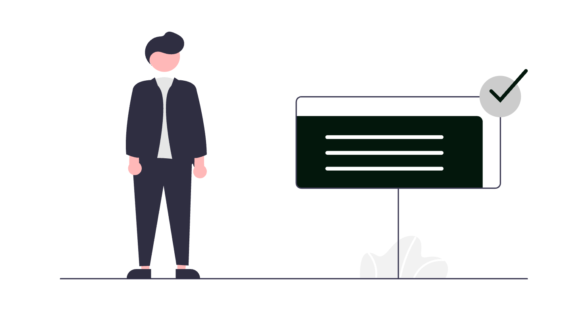

# Pagini de arii de practică pe website-ul de avocat: cum le structurezi

Pe multe website-uri de avocat, ariile de practică sunt o listă de cinci rânduri: „Drept civil, Drept penal, Dreptul familiei, Drept comercial, Dreptul muncii”. Omul care are o problemă concretă nu află din ea dacă situația lui intră acolo, ce trebuie să aducă la prima discuție sau cum se desfășoară colaborarea. În ghidul de mai jos vezi cum transformi lista într-o pagină separată pentru fiecare arie, cu o structură pe care o poți copia.

<div class="row justify-content-center my-4">
  <div class="col-md-8">
    
  </div>
</div>

## 1. De ce lista de domenii nu ajută pe nimeni

Un potențial client nu caută „drept civil”. Caută „partaj după divorț”, „contestație la executare” sau „concediere disciplinară”. O listă de denumiri juridice îi spune ce ai studiat, nu dacă îl poți ajuta pe el.

Lista are și o problemă tehnică. O singură pagină care enumeră zece domenii nu are, pentru niciunul dintre ele, suficient text ca să răspundă unei căutări. Pentru Google, pagina „Servicii” rămâne una generică.

O pagină de arie de practică bine făcută răspunde, în ordine, la patru întrebări pe care și le pune omul de dincolo de ecran:

1. Este situația mea una de care se ocupă acest cabinet?
2. Ce trebuie să pregătesc?
3. Cum ar arăta colaborarea, pas cu pas?
4. Ce întrebări am înainte să sun?

## 2. O pagină pentru fiecare arie, nu o pagină pentru toate

Regula de bază este simplă: fiecare arie în care lucrezi efectiv primește propria pagină, cu propria adresă. Pagina generală „Arii de practică” rămâne, dar devine un cuprins: un paragraf scurt pentru fiecare arie și un link către pagina ei.

Structura arată așa:

```
/arii-de-practica/                      → cuprins, câte un paragraf pe arie
/arii-de-practica/dreptul-familiei/     → pagina completă
/arii-de-practica/drept-civil/          → pagina completă
/arii-de-practica/dreptul-muncii/       → pagina completă
```

Dacă o arie are subteme frecvente (de exemplu divorțul și partajul în dreptul familiei), le tratezi întâi ca secțiuni în aceeași pagină. Le muți pe pagini separate doar când ai destul conținut util pentru fiecare.

## 3. Ce arii primesc o pagină

Nu face pagini pentru domenii în care nu lucrezi de fapt, doar ca să acoperi mai multe căutări. Pe lângă riscul deontologic, o pagină goală sau copiată de la alt cabinet nu ajută pe nimeni.

Un filtru practic:

- Ai lucrat în ultimii ani dosare în aria respectivă și vrei să lucrezi în continuare?
- Poți scrie, din experiența ta, ce acte cere de obicei o astfel de situație?
- Poți explica etapele colaborării fără să copiezi textul altcuiva?

Dacă răspunsul este „da” la toate trei, aria merită o pagină. Dacă nu, o menționezi doar în paragraful de prezentare a cabinetului sau o lași deoparte.

## 4. Structura recomandată a unei pagini de arie de practică

Fiecare pagină urmează aceeași schemă, ca vizitatorul să se orienteze ușor de la o arie la alta:

<div class="table-wrap">

| Secțiune | Ce conține | Lungime orientativă |
|---|---|---|
| Titlu și introducere | Aria, descrisă cu situațiile oamenilor, nu doar cu denumirea juridică | 2-4 propoziții |
| Pentru cine este | Tipurile de situații de care te ocupi | 4-8 exemple |
| Ce acte pregătești | Documentele care se cer de obicei la prima discuție | listă scurtă |
| Cum decurge colaborarea | Etapele, de la primul contact la închiderea mandatului | 4-6 pași |
| Întrebări frecvente | Întrebările pe care le primești des | 4-6 întrebări |
| Contact | Cum te contactează omul și ce se întâmplă după | 1-2 propoziții |

</div>

În secțiunile următoare iei fiecare bucată pe rând.

## 5. Pentru cine este pagina

Aici înlocuiești denumirea juridică cu situații reale, descrise în cuvintele clientului. Pentru dreptul familiei, de exemplu:

- divorț, prin acord sau pe cale judecătorească;
- partajul bunurilor comune;
- stabilirea locuinței copilului și a programului de legături personale;
- pensia de întreținere;
- acte și convenții între soți.

Fiecare exemplu este un tip de situație, nu un caz. Nu scrii despre dosare concrete, nu dai nume și nu dai detalii după care cineva ar putea recunoaște un client.

Ajută și o propoziție despre ce **nu** faci. „Nu ne ocupăm de dosare penale” scutește pe toată lumea de un telefon inutil.

## 6. Ce acte și informații să pregătească clientul

Secțiunea aceasta este, de multe ori, cea mai utilă din pagină. Omul vine mai pregătit la prima discuție, iar tu pierzi mai puțin timp cerând documente pe rând.

Formulează lista ca orientare, nu ca listă completă:

- actul de identitate;
- actele care privesc situația (contracte, notificări, hotărâri, corespondență);
- un rezumat scurt, în scris, cu datele importante;
- termenele pe care le cunoaște deja (de exemplu, data la care a primit un act).

Adaugă o propoziție de tipul „Lista exactă depinde de situație și o stabilim împreună la prima discuție”. Așa nu creezi impresia că lista acoperă orice caz.

## 7. Cum decurge colaborarea

Omul care nu a mai lucrat cu un avocat nu știe ce urmează după primul telefon. Descrie etapele, fără termene și fără rezultate promise:

1. Primul contact: telefon, e-mail sau formularul de pe website.
2. Discuția inițială: înțelegi situația și spui dacă și cum poți ajuta.
3. Contractul de asistență juridică: stabiliți obiectul mandatului și onorariul.
4. Lucrul propriu-zis: documentare, acte, termene, reprezentare.
5. Informarea pe parcurs: cum și cât de des primește clientul vești.
6. Închiderea mandatului: ce primește clientul la final.

Nu scrii aici cât durează un proces sau ce șanse are cineva. Asta discuți cu fiecare client, după ce vezi actele.

## 8. Întrebările frecvente din pagină

Fiecare pagină de arie se încheie cu 4-6 întrebări pe care le auzi des la telefon. Răspunsurile sunt scurte, generale și adevărate pentru orice situație de acel tip.

Acolo unde răspunsul depinde de caz, spui asta direct.

Două lucruri bune de știut despre secțiunea FAQ:

- Din august 2023, Google afișează rezultatele îmbogățite de tip FAQ doar pentru website-uri guvernamentale și de sănătate cu autoritate recunoscută ([anunțul Google Search Central](https://developers.google.com/search/blog/2023/08/howto-faq-changes)). Marcajul FAQPage nu îți aduce, deci, un rezultat extins în Google. Îl poți păstra pentru claritatea datelor structurate.
- Secțiunea rămâne utilă pentru oameni. Un răspuns scurt, care se înțelege fără restul paginii, este ușor de citit și de preluat corect.

Detaliile despre datele structurate sunt explicate în [glosarul de marketing digital pentru avocați](../glosar-marketing-digital-avocati/).

<div class="row justify-content-center my-4">
  <div class="col-md-9">
    
  </div>
</div>

## 9. Ce nu scrii pe o pagină de arie de practică

Pagina de arie de practică este publicitate profesională, deci intră sub regulile profesiei. Înainte să publici, recitește ghidul despre [ce are voie un avocat să publice online](../ce-are-voie-avocat-sa-publice-online/). Acolo găsești limitele, cu trimiteri la textele aplicabile.

În practică, pe pagina de arie evită:

- promisiuni sau sugestii de rezultat („câștigăm”, „garantat”, procente de succes);
- nume de clienți, dosare concrete, mulțumiri publice sau testimoniale;
- comparații cu alți avocați și superlative („cel mai bun”, „nr. 1”);
- termeni precum „specialist” sau „expert”, dacă nu corespund unei specializări sau unui titlu dobândit potrivit legii;
- onorarii, până nu verifici regulile aplicabile și, la nevoie, nu întrebi baroul.

## 10. Adresa, titlul și descrierea fiecărei pagini

Fiecare pagină are nevoie de câteva elemente tehnice simple:

- **Adresa (URL)**: scurtă, fără diacritice, cu cratime: `/arii-de-practica/dreptul-familiei/`.
- **Titlul paginii (title)**: aria și orașul, de exemplu „Avocat dreptul familiei în Cluj-Napoca | Cabinet X”.
- **Descrierea (meta description)**: o propoziție despre situațiile de care te ocupi, nu o listă de cuvinte cheie.
- **Un singur titlu principal (H1)**, apoi subtitluri pentru fiecare secțiune.
- **Legături interne**: de la cuprins la fiecare arie, de la fiecare arie înapoi la cuprins și la pagina de contact, plus articolele de blog care tratează subiecte din aria respectivă.

Dacă vrei să înțelegi cum se leagă aceste elemente de vizibilitatea în Google, citește ghidul despre [servicii SEO profesionale juridice](../servicii-seo-profesionale-juridice/).

## 11. Paginile de arii și răspunsurile asistenților AI

Tot mai mulți oameni pun întrebări juridice în ChatGPT, Gemini sau în rezultatele AI din Google. Nu există o rețetă care să garanteze că un cabinet apare acolo. O pagină clară, cu aria, orașul, situațiile tratate și răspunsuri scurte, este însă mai ușor de înțeles corect decât o listă de cinci cuvinte.

Despre cum citesc aceste instrumente informațiile despre un cabinet, ai ghidul separat: [cum apare un avocat în răspunsurile ChatGPT, Gemini și Google AI Overviews](../avocat-chatgpt-gemini-ai-overviews/).

## 12. Șablonul pe care îl copiezi

Copiază schema de mai jos pentru fiecare arie și completează câmpurile dintre paranteze:

```
TITLU (H1): [Aria], în cuvintele clientului
  ex.: „Dreptul familiei: divorț, partaj, custodie”

INTRODUCERE (2-4 propoziții)
  Ce situații acoperă aria. Unde lucrezi (orașul, instanțele).

PENTRU CINE ESTE
  - [situația 1]
  - [situația 2]
  - [situația 3]
  Nu ne ocupăm de: [ce rămâne în afară]

CE ACTE PREGĂTEȘTI
  - [act 1]
  - [act 2]
  „Lista exactă o stabilim împreună la prima discuție.”

CUM DECURGE COLABORAREA
  1. Primul contact
  2. Discuția inițială
  3. Contractul de asistență juridică
  4. Lucrul pe dosar
  5. Cum te informăm pe parcurs
  6. Închiderea mandatului

ÎNTREBĂRI FRECVENTE (4-6)
  Î: [întrebarea]  R: [răspuns scurt, general, fără promisiuni]

CONTACT
  Cum ne scrii sau ne suni și ce se întâmplă după.
```

## 13. Checklist înainte de publicare

- Fiecare arie în care lucrezi efectiv are pagina ei, cu adresă proprie.
- Pagina „Arii de practică” este un cuprins, cu link către fiecare arie.
- Situațiile sunt descrise în cuvintele clientului, nu doar cu denumirea juridică.
- Lista de acte este prezentată ca orientare, nu ca listă completă.
- Etapele colaborării nu conțin termene sau rezultate promise.
- Întrebările frecvente au răspunsuri scurte și generale.
- Nu apar nume de clienți, dosare, testimoniale, superlative sau comparații.
- Titlul, descrierea și adresa fiecărei pagini sunt completate.
- Fiecare pagină are link către contact și înapoi la cuprins.
- Ai recitit pagina cu regulile de publicitate ale profesiei în minte.

Dacă pornești de la zero, ghidul de [creare a unui website pentru avocați](../creare-site-avocati/) îți arată unde se încadrează aceste pagini în structura întregului website.

## Întrebări frecvente

### Câte pagini de arii de practică îmi trebuie?

Câte o pagină pentru fiecare arie în care lucrezi efectiv. Pentru un cabinet mic pot fi doar două sau trei pagini, și e în regulă. Nu face pagini pentru domenii în care nu lucrezi doar ca să apari la mai multe căutări.

### Pot pune toate ariile pe o singură pagină?

Poți, dar pagina rămâne generică. Varianta mai utilă este o pagină de cuprins, cu un paragraf scurt pe arie, și câte o pagină completă pentru fiecare arie, cu situațiile, actele, etapele colaborării și întrebările frecvente.

### Cât de lungă trebuie să fie o pagină de arie de practică?

Nu există o lungime obligatorie. Contează să răspundă la întrebările reale ale clientului: pentru cine este, ce acte pregătește, cum decurge colaborarea și ce întrebări frecvente apar. De obicei, asta înseamnă câteva sute de cuvinte, nu un singur paragraf.

### Pot scrie că sunt specialist într-o arie?

Doar dacă termenul corespunde unei specializări sau unui titlu dobândit potrivit legii. Altfel, descrii pur și simplu activitatea și situațiile de care te ocupi. Regulile de publicitate ale profesiei sunt explicate în ghidul SOLON despre ce are voie un avocat să publice online.

### Marcajul FAQPage îmi aduce un rezultat extins în Google?

De regulă, nu. Din august 2023, Google afișează rezultatele de tip FAQ doar pentru website-uri guvernamentale și de sănătate cu autoritate recunoscută. Secțiunea de întrebări frecvente rămâne utilă pentru vizitatori, iar marcajul poate rămâne pentru claritatea datelor structurate.

## Concluzie

O pagină de arie de practică bine făcută nu înseamnă mai multe cuvinte cheie. Înseamnă să răspunzi, în ordine, la întrebările omului care are o problemă: dacă situația lui intră aici, ce să pregătească, cum decurge colaborarea și ce trebuie să mai știe înainte să te sune.

Limita este de timp: fiecare pagină cere informații pe care doar tu le ai și o recitire atentă cu regulile profesiei în minte. Structura de mai sus te scutește doar de pagina goală.

Dacă dorești să structurezi paginile de arii de practică pe website-ul cabinetului tău, cu un șablon adaptat ariilor în care lucrezi, echipa **SOLON** oferă consultanță de digitalizare adaptată specificului practicii tale juridice.

---

> *Prezentul articol are un caracter pur informativ și educațional și nu constituie consultanță juridică în sensul Legii nr. 51/1995. Pentru o situație concretă, consultă un avocat.*
>
> *Articol redactat cu asistență AI, verificat și asumat editorial de echipa SOLON.*
