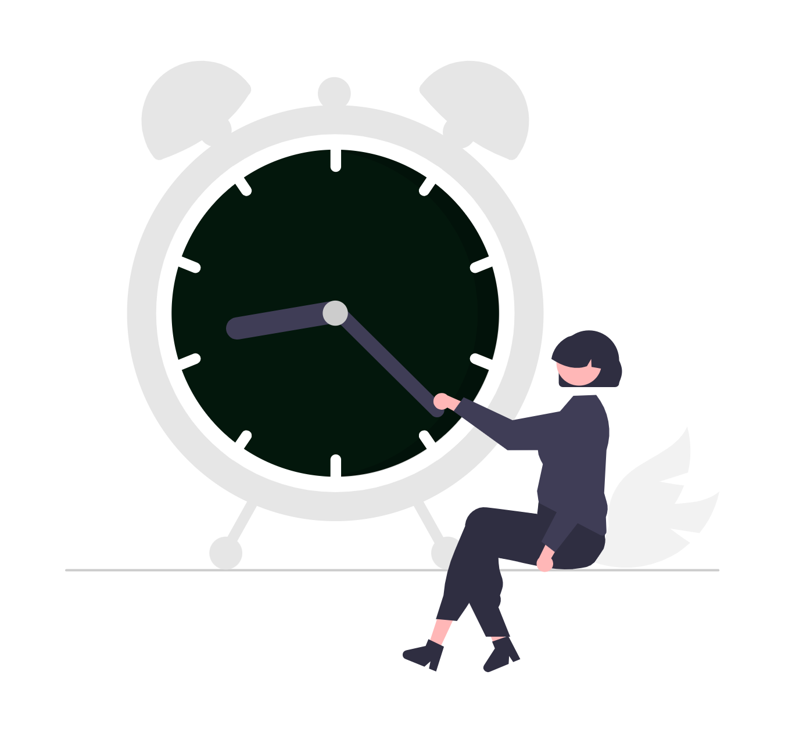

# Viteza website-ului de avocat: ce măsori și ce repari primul

Un potențial client caută un avocat pe telefon, între două întâlniri, și deschide website-ul tău. Pagina rămâne albă câteva secunde, apoi textul sare când se încarcă o imagine, iar butonul de apel nu răspunde la prima atingere. Mulți nu așteaptă și se întorc la rezultatele căutării. Vestea bună: viteza se poate măsura cu instrumente gratuite, iar o parte din reparații le poți face chiar tu.

  

    
  

*Actualizat: octombrie 2026.*

Articolul acesta intră doar în partea de viteză. Dacă vrei verificarea completă a website-ului (Google, contact, profil, domeniu), pornește de la ghidul despre [auditul website-ului de avocat](../audit-website-avocat/), iar dacă un termen îți sună necunoscut, îl găsești explicat în [glosarul de marketing digital pentru avocați](../glosar-marketing-digital-avocati/).

## 1. Ce înseamnă un website „lent”: cele trei Core Web Vitals

Google a grupat experiența de încărcare în trei măsurători, numite **Core Web Vitals**. Pragurile de mai jos sunt cele publicate de Google pe web.dev pentru o experiență „bună”:

| Măsurătoare | Ce arată, pe înțeles | Prag „bun” |
|---|---|---|
| **LCP** (Largest Contentful Paint) | cât durează până apare cel mai mare element vizibil, de obicei imaginea principală sau titlul | cel mult 2,5 secunde |
| **INP** (Interaction to Next Paint) | cât de repede reacționează pagina când atingi un buton sau deschizi meniul | cel mult 200 de milisecunde |
| **CLS** (Cumulative Layout Shift) | cât de mult „sare” conținutul în timpul încărcării | cel mult 0,1 |

Două detalii contează. Primul: pragurile se evaluează la 75% dintre vizite, separat pe mobil și pe desktop, deci nu ajunge ca pagina să meargă repede pe laptopul tău. Al doilea: INP a înlocuit în 2024 vechea măsurătoare FID, așa că ghidurile mai vechi care vorbesc despre FID sunt depășite.

## 2. Cum măsori pe telefon, gratuit

Ai nevoie de trei instrumente, toate gratuite:

1. **PageSpeed Insights** (pagespeed.web.dev). Introdu adresa paginii și citește întâi fila **Mobil**. Secțiunea de sus arată datele reale ale vizitatorilor din Chrome, dacă website-ul are suficient trafic. Secțiunea de jos este un test de laborator, util pentru diagnostic. Testul de laborator nu poate măsura INP, pentru că nu există un om care apasă pe ceva; în locul lui vezi TBT (Total Blocking Time), un indicator apropiat.
2. **Raportul Core Web Vitals din Google Search Console**. Grupează paginile în „bune”, „necesită îmbunătățiri” și „slabe”, pe baza datelor reale. Dacă nu ai configurat încă Search Console, ghidul [cum să folosești Google Search Console ca avocat](../cum-sa-folosesti-google-search-console-ca-avocat/) te ajută să pornești.
3. **Propriul telefon**, pe date mobile, nu pe Wi-Fi. Deschide prima pagină, pagina de contact și o pagină de arie de practică. Notează cât aștepți până vezi textul principal, dacă ceva sare și dacă butonul de apel răspunde imediat.

Testează mai multe pagini, nu doar prima. Pagina de contact și paginile de servicii sunt adesea cele pe care ajunge un client din Google.

## 3. Ce înseamnă rezultatul, pe scurt

- **LCP mare**: de cele mai multe ori, o imagine principală prea grea, un server care răspunde încet sau resurse care blochează afișarea.
- **INP mare**: prea mult JavaScript, de obicei de la pluginuri, constructoare vizuale de pagini sau scripturi externe (chat, hărți, pixeli de urmărire).
- **CLS mare**: imagini fără dimensiuni declarate, fonturi care se schimbă după încărcare, bannere de cookie sau widgeturi care împing conținutul în jos.

## 4. Lista de 10 reparații, ordonate după efort

Începe de sus. Primele puncte cer puțin timp și, de regulă, nu necesită un developer.

### Efort mic (le poți face de obicei singur)

1. **Comprimă și redimensionează imaginile.** O fotografie de 4–5 MB încărcată direct din telefon sau din aparat este una dintre cele mai frecvente cauze ale unui LCP mare. Exportă imaginile la dimensiunea la care apar efectiv și folosește formate moderne, precum WebP sau AVIF.
2. **Nu amâna încărcarea imaginii principale.** Încărcarea întârziată („lazy loading”) e bună pentru imaginile de mai jos în pagină, dar nu pentru imaginea care apare prima pe ecran. Google recomandă ca imaginea principală să nu aibă atributul `loading="lazy"` și, ideal, să primească `fetchpriority="high"`.
3. **Declară dimensiunile imaginilor.** Atributele `width` și `height` (sau echivalentul lor în CSS) rezervă spațiul înainte ca imaginea să se încarce, așa că textul nu mai sare. Este una dintre cele mai simple reparații pentru CLS.
4. **Șterge pluginurile și widgeturile pe care nu le folosești.** Fiecare plugin poate adăuga fișiere încărcate pe fiecare pagină. Dezactivează-le pe cele de care nu ai nevoie, apoi testează din nou.
5. **Fă inventarul scripturilor externe.** Chat, hărți încorporate, video, pixeli de urmărire, butoane de rețele sociale: păstrează-le doar pe cele pe care le folosești efectiv și, unde se poate, încarcă-le doar pe paginile unde sunt necesare (harta doar pe pagina de contact, nu pe toate).

### Efort mediu (de obicei cu ajutorul cuiva tehnic)

6. **Pune ordine în fonturi.** Folosește cât mai puține familii și grosimi de font și configurează afișarea astfel încât textul să fie vizibil imediat, chiar înainte să se încarce fontul final. Așa reduci și întârzierea, și „săritura” textului.
7. **Activează cache-ul și un CDN.** Cache-ul permite reutilizarea fișierelor deja descărcate, iar un CDN servește website-ul de pe servere apropiate de vizitator. Google recomandă CDN-ul ca una dintre cele mai eficiente metode de a reduce timpul până la primul răspuns al serverului (TTFB).
8. **Amână JavaScript-ul care nu e necesar la început.** Scripturile care nu sunt nevoie la prima afișare pot fi încărcate după conținutul principal. Ajută atât LCP, cât și INP.

### Efort mare (decizii de proiect)

9. **Verifică hostingul.** Dacă serverul răspunde constant încet, chiar și pe o pagină simplă, problema poate fi la găzduire. O mutare cere planificare: backup, test, redirecționări și verificare după lansare.
10. **Regândește tema sau constructorul de pagini.** Unele teme încarcă mult cod pentru funcții pe care nu le folosești. Dacă reparațiile de mai sus nu ajung, uneori o temă mai simplă sau o refacere a website-ului este soluția mai stabilă pe termen lung. Ghidul despre [crearea unui website pentru avocați](../creare-site-avocati/) explică pașii unui astfel de proiect.

După fiecare reparație, testează din nou aceeași pagină, pe mobil, ca să vezi ce a schimbat efectiv.

## 5. Viteza și Google: ce poți aștepta

Google spune că un Core Web Vitals bun, împreună cu alte aspecte ale experienței pe pagină, se aliniază cu ce urmăresc sistemele sale de clasare. Asta înseamnă că viteza **poate contribui** la felul în care website-ul tău apare în căutări, dar **nu garantează nicio poziție în Google**. Un website rapid, dar cu conținut subțire, nu va depăși automat o pagină mai lentă, dar mult mai utilă. Gândește viteza în primul rând ca pe o chestiune de respect față de timpul celui care te caută.

## 6. Ce să nu faci

- Nu urmări scorul 100 cu orice preț. Contează datele reale ale vizitatorilor, nu cifra de laborator.
- Nu instala trei pluginuri „de optimizare” deodată. Se pot suprapune și pot strica afișarea.
- Nu modifica tema direct pe website-ul live. Lucrează pe o copie sau fă întâi un backup.
- Nu testa o singură dată. Viteza se schimbă după fiecare plugin, imagine sau script nou.

## Checklist rapid

- [ ] Am testat prima pagină, pagina de contact și o pagină de servicii în PageSpeed Insights, pe mobil.
- [ ] Am deschis website-ul pe telefon, pe date mobile.
- [ ] Imaginile sunt comprimate, la dimensiunea corectă și au dimensiuni declarate.
- [ ] Imaginea principală nu are încărcare întârziată.
- [ ] Am eliminat pluginurile și scripturile externe pe care nu le folosesc.
- [ ] Am verificat raportul Core Web Vitals din Search Console.
- [ ] Am programat o verificare lunară, inclusiv după orice schimbare mare.

Viteza nu se repară o singură dată. Fiecare actualizare de temă, plugin nou sau imagine mare o poate schimba, de aceea merită inclusă în [mentenanța periodică a website-ului](../mentenanta-site-avocati/).

## Întrebări frecvente

### Ce înseamnă, concret, un website lent?

Google folosește trei repere, numite Core Web Vitals: conținutul principal ar trebui să apară în cel mult 2,5 secunde (LCP), pagina ar trebui să reacționeze la o atingere sau un clic în cel mult 200 de milisecunde (INP), iar elementele nu ar trebui să se miște în timpul încărcării (CLS de cel mult 0,1). Pragurile se măsoară la 75% dintre vizite, separat pe mobil și pe desktop.

### Cum îmi testez viteza website-ului de pe telefon?

Deschide PageSpeed Insights, introdu adresa paginii și citește întâi fila pentru mobil. Partea de sus arată datele reale ale vizitatorilor, dacă există suficiente; partea de jos este un test de laborator. Apoi deschide pagina pe propriul telefon, pe date mobile, nu pe Wi-Fi, și observă cât aștepți până vezi textul principal și butonul de contact.

### Contează viteza pentru poziția în Google?

Poate contribui. Google spune că un Core Web Vitals bun, împreună cu alte aspecte ale experienței pe pagină, se aliniază cu ce urmăresc sistemele sale de clasare. Viteza nu garantează însă nicio poziție; relevanța și calitatea conținutului rămân esențiale.

### Ce pot repara singur și când am nevoie de un developer?

De obicei poți face singur: comprimarea și redimensionarea imaginilor, eliminarea pluginurilor și a widgeturilor pe care nu le folosești și verificarea scripturilor adăugate de-a lungul timpului. Pentru fonturi, prioritatea imaginii principale, cache, CDN, schimbarea hostingului sau rescrierea temei e mai sigur să lucrezi cu cineva tehnic.

### Scorul din PageSpeed Insights trebuie să fie 100?

Nu. Scorul de laborator este un indicator util pentru diagnostic, dar ce contează mai mult sunt datele reale ale vizitatorilor pentru LCP, INP și CLS. Un website poate avea un scor sub 100 și totuși să ofere o experiență bună.

### Cât de des ar trebui să verific viteza?

Merită verificată după orice schimbare mare (temă nouă, plugin nou, widget de chat, video pe prima pagină) și, în rest, periodic, de exemplu o dată pe lună, în raportul Core Web Vitals din Google Search Console.

## Surse

- [Web Vitals](https://web.dev/articles/vitals) - web.dev (Google), accesat 26.10.2026
- [The most effective ways to improve Core Web Vitals](https://web.dev/articles/top-cwv) - web.dev (Google), accesat 26.10.2026
- [Understanding Core Web Vitals and Google search results](https://developers.google.com/search/docs/appearance/core-web-vitals) - Google Search Central, accesat 26.10.2026
- [PageSpeed Insights](https://pagespeed.web.dev/) - Google

## Despre autor

Ghidul este realizat de echipa SOLON, agenția digitală pentru avocați din România. Lucrăm cu cabinete și societăți de avocatură la website-uri, SEO și comunicare online. Alte resurse pe [solon.agency](https://solon.agency/).

Dacă vrei ca website-ul cabinetului tău să fie verificat periodic, inclusiv la capitolul viteză, echipa SOLON te poate ajuta prin QA Website sau Mentenanță anuală website. Poți [programa gratuit o sesiune de consultanță digitală de 30 de minute](https://solon.agency/programare-consultanta-gratuita/) ca să vezi ce merită reparat primul.
